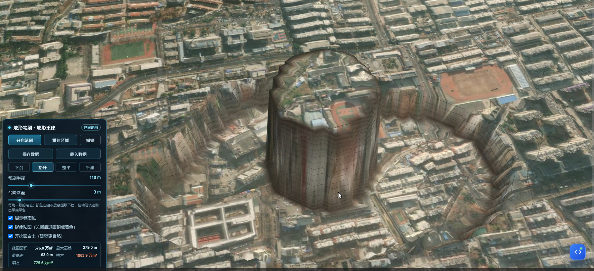
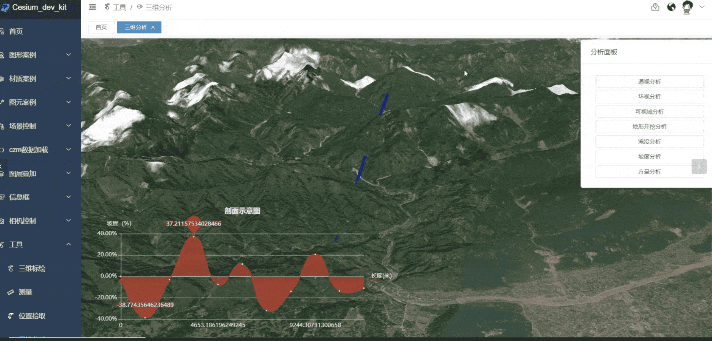
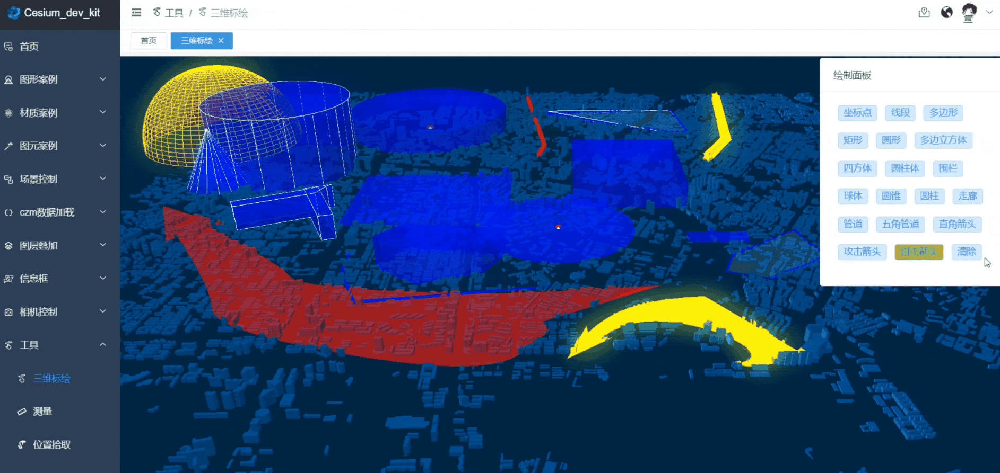
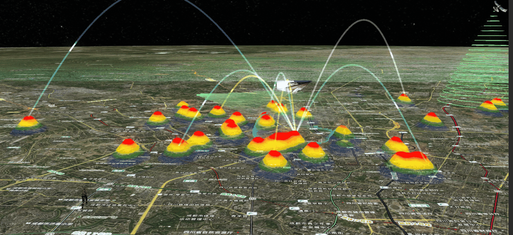
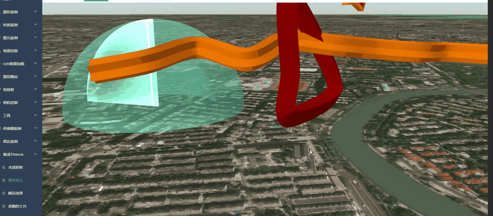
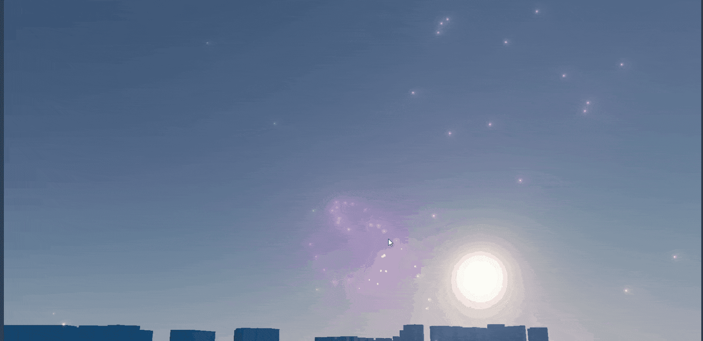
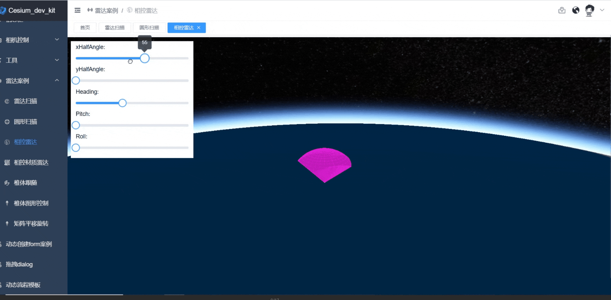
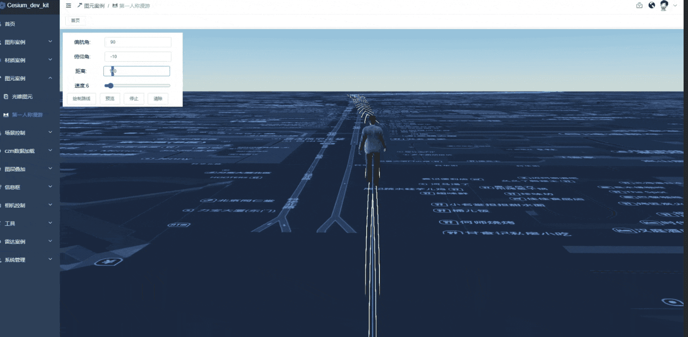
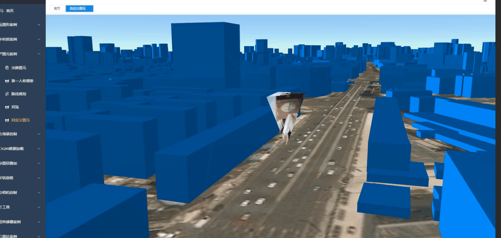

## cesium_dev_kit

[![Build Status][build-main]][build-status]
[![NPM Package][npm]][npm-url]
[![NPM Downloads][npm-download]][npmtrends-url]
[![Build Size][build-size]][build-size-url]
[![GitHub Repo stars][repo-stars]][star-chart]
[![license][license-uri]][license-link]

**English** | [中文](./README.md)

> Cesium toolkit for business development: plotting, measurement and calculation, spatial analysis, custom materials/entities, sensors, post-processing special effects, terrain editing, and deep integration with Three.js in a single context. It can be introduced as needed and is not bound to any front-end framework.



### Why choose it

- **Import only what you need**: 18 subpaths (`/graphics`, `/analysis`, `/three`, `/terrain`, ...) — use only what you install, without pulling in `echarts` / `dat.gui`.
- **Rare capabilities**: terrain editing (excavation / raise / terraces / water / cut-fill) and Three.js single-context fusion (sharing Cesium's canvas and depth buffer) are uncommon in the Cesium ecosystem.
- **Framework-agnostic**: a plain API that works in React / Vue / vanilla; `createKit()` has a clear lifecycle and an idempotent `dispose()`.
- **Maintainable**: TypeScript types, stable error codes, 477 APIs, 70+ live examples, docs and demo match one-to-one.

### 30-second quick start

```bash
npm install cesium_dev_kit cesium
```

```ts
import * as Cesium from 'cesium'
import { createKit } from 'cesium_dev_kit'

const kit = createKit({
  Cesium,
  containerId: 'cesiumContainer'
})

kit.graphics.createPolygonGraphics({
  positions: Cesium.Cartesian3.fromDegreesArray([
    104.09, 30.65, 104.11, 30.65, 104.10, 30.63
  ]),
  material: Cesium.Color.RED.withAlpha(0.3),
  clampToGround: true
})

// Dispose when the page / route unmounts (idempotent)
kit.dispose()
```

> Requires Cesium `>=1.105`; `three`, `echarts`, `dat.gui` and `libgif` are optional peer dependencies (installed only when their features are used).
> The library no longer ships a Cesium Ion token. Pass your own via `extraConfig.AccessToken` or set `Cesium.Ion.defaultAccessToken` before creating the viewer.

**Docs**: [API docs](https://dengxiaoning.github.io/cesium_dev_kit/) ·
[Examples (70+)](https://dengxiaoning.github.io/cesium_dev_kit/examples/) ·
[Live demo](https://dengxiaoning.github.io/cesium_dev_kit/demo/?auto=1) ·
[中文](./README.md)

## API documentation & live demo

- API docs: [:bookmark_tabs: https://dengxiaoning.github.io/cesium_dev_kit/](https://dengxiaoning.github.io/cesium_dev_kit/)
- Examples: [:jigsaw: https://dengxiaoning.github.io/cesium_dev_kit/examples/](https://dengxiaoning.github.io/cesium_dev_kit/examples/)
- Live demo: [:rocket: https://dengxiaoning.github.io/cesium_dev_kit/demo/?auto=1](https://dengxiaoning.github.io/cesium_dev_kit/demo/?auto=1)
- AI index: [llms.txt](https://dengxiaoning.github.io/cesium_dev_kit/llms.txt) · [api-index.json](https://dengxiaoning.github.io/cesium_dev_kit/api-index.json)

All three live on the same GitHub Pages site: docs at the root, example pages under `/examples/`, and
the demo under `/demo/`. The demo logs in with a mock account (`?auto=1`), and its sidebar lists every
example, matching the classes in the docs one by one.

The docs are generated from the JSDoc comments under `src/utils/cesiumPluginsExtends` (TypeDoc):

```bash
npm run docs             # build API docs into docs/
npm run build:demo:pages # build the demo into docs/demo/
npm run docs:serve       # local preview at http://localhost:5174
```

Pushing to `main` triggers `.github/workflows/docs.yml`, which builds both and deploys to GitHub Pages.

## Features
| |||
| :----------------------------------------------------: |:----------------------------------------------------:|:-------------------------------------: | 
|                terrainEdit               |                         analysis    |                                                   标绘   |
||||
|                        heatmap3d |                 extrude         |           fireworksEffect      |
||| |
|                radar          |                            roaming              |                  custPrimitive          |

[More>>](https://dengxiaoning.github.io/cesium_dev_kit/demo/?auto=1)

## Install

```shell
npm install cesium_dev_kit cesium
# optional: only needed for the Three.js integration
npm install three
```

> Requires Cesium `>=1.105`. `three`, `echarts`, `dat.gui` and `libgif` are optional peer dependencies (installed only when their features are used).
> The library no longer ships a Cesium Ion token. Pass your own token via
> `extraConfig.AccessToken` or set `Cesium.Ion.defaultAccessToken` before creating the viewer.

## Cesium static assets (required)

`cesium_dev_kit` draws on top of Cesium but does not ship Cesium's own runtime assets. Before the
first render, `Assets/`, `Workers/`, `ThirdParty/` and `Widgets/widgets.css` must be reachable —
otherwise you get a blank globe, missing terrain/imagery workers, or unstyled widgets.

**Vite (recommended)** — one plugin does the copying for you:

```bash
npm i -D vite-plugin-cesium
```

```ts
// vite.config.ts
import { defineConfig } from 'vite'
import cesium from 'vite-plugin-cesium'

export default defineConfig({ plugins: [cesium()] })
```

**Manual (webpack / Rspack / Rollup)**

1. Copy `node_modules/cesium/Build/Cesium/{Assets,Workers,ThirdParty,Widgets}` into your public
   directory, e.g. `public/cesium/`.
2. Point Cesium at it **before** Cesium is imported: `window.CESIUM_BASE_URL = '/cesium/'`.
3. Import the widget styles: `import 'cesium/Build/Cesium/Widgets/widgets.css'`.

Give the container an explicit size, or the canvas collapses to 0px:

```css
#cesiumContainer {
  width: 100%;
  height: 100%;
}
```

Also make sure `Cesium.Ion.defaultAccessToken` is set, or pass `extraConfig.AccessToken`.

## Quick start

### Import only what you need (recommended)

```ts
import * as Cesium from 'cesium'
import { Graphics } from 'cesium_dev_kit/graphics'

// Your own token, e.g. from an environment variable
Cesium.Ion.defaultAccessToken = import.meta.env.VITE_CESIUM_ION_TOKEN

const { viewer, graphics, dispose } = Graphics({
  cesiumGlobal: Cesium,
  containerId: 'cesiumContainer'
})

graphics.flyTo({
  position: { x: -1337132, y: 5330611, z: 3228680 }
})

// Call this when the page / route is unmounted
dispose()
```

Each subpath only bundles its own dependency graph. For example
`cesium_dev_kit/graphics` does not pull in `echarts` or `dat.gui`.
Available subpaths: `/graphics`, `/material`, `/primitive`, `/draw`, `/analysis`,
`/plugin`, `/pass-effect`, `/control`, `/three`, `/vue`, `/react`, `/plot`,
`/history`, `/annotation`, `/web-components`, `/custom-cesium-plugin`,
`/default-static`, `/terrain`.

### Default images and assets

Many helpers (sky box, point icon, light cone, water, analysis textures) fall
back to a small set of default images. If you do not pass `defaultStatic`, the
kit uses its built-in CDN config so that a fresh install works without 404s:

```ts
import { defaultStatic, createDefaultStatic } from 'cesium_dev_kit/default-static'

// 1. Use the built-in CDN (default)
// 2. Use your own CDN
const myStatic = createDefaultStatic('https://cdn.example.com/')
// 3. Use relative paths and self-host ./public/static from this repo
const localStatic = createDefaultStatic('')
```

### Import all modules

```ts
import * as Cesium from 'cesium'
import { initCesium } from 'cesium_dev_kit'

const kit = initCesium({
  cesiumGlobal: Cesium,
  containerId: 'cesiumContainer',
  extraConfig: { AccessToken: 'YOUR_CESIUM_ION_TOKEN' }
})

const { viewer, graphics, primitive, analysis } = kit
// ...

// Destroys the viewer created by the kit.
// If you passed an existing `viewer`, the kit will not destroy it.
kit.dispose()
```

### Recommended entry: `createKit`

`createKit` takes the same options as `initCesium` but returns an explicit context and has a clearer `dispose()` contract:

```ts
import * as Cesium from 'cesium'
import { createKit } from 'cesium_dev_kit'

const kit = createKit({
  Cesium,                     // `cesiumGlobal` also works
  containerId: 'cesiumContainer',
  assetsBaseUrl: '/static/',  // same as createDefaultStatic('/static/')
  extraConfig: { AccessToken: import.meta.env.VITE_CESIUM_ION_TOKEN },
  onError: (err, ctx) => console.warn(ctx?.scope, err)
})

kit.context.viewer // identical to kit.viewer
kit.graphics.createDynamicCircleGraphics({ /* ... */ })
kit.dispose() // idempotent; kit.isDisposed() reports the state
```

Contract:

- If the kit created the viewer, `dispose()` calls `viewer.destroy()`;
- If you passed your own viewer, `dispose()` only removes DataSources/listeners added by the kit and never destroys your viewer;
- Multiple kits can coexist on one page — modules no longer share module-level `Cesium` / `dfSt` state;
- The legacy `new initCesium({...})` form still works but is a compatibility entry; prefer `createKit` for new code.

### Error handling

Errors thrown by the library are `CesiumDevKitError` with a stable `code`:

```ts
import { isCesiumDevKitError, setErrorHandler } from 'cesium_dev_kit'

try {
  const kit = createKit({ Cesium, containerId: 'cesiumContainer' })
} catch (err) {
  if (isCesiumDevKitError(err) && err.code === 'MISSING_VIEWER') {
    // provide a container
  }
}

// Non-fatal errors caught internally default to console.warn
setErrorHandler((err, ctx) => console.warn(ctx?.scope, err))
```

Codes: `MISSING_CESIUM`, `MISSING_VIEWER`, `INVALID_ARGUMENT`, `IMAGERY_FAILED`,
`OPTIONAL_DEPENDENCY_MISSING`, `UNSUPPORTED_ENVIRONMENT`, `UNSUPPORTED_CESIUM_VERSION`, `INTERNAL`.

> Naming: `craete*` methods now have canonical `create*` names (e.g. `craeteDynamicCricleGraphics` →
> `createDynamicCircleGraphics`). The old names remain and are marked `@deprecated`.


### Script tag / no bundler

Current releases ship only ESM (`dist/*.mjs`) and CJS (`dist/*.cjs`) builds. `index.umd.js` and the
`window.cesium_dev_kit` global are **no longer published**, so the old
`<script src="index.umd.js">` snippet will 404. For a plain HTML page, bundle a small entry with
Vite in `iife` format:

```ts
// vite.config.ts
export default {
  build: {
    lib: { entry: 'src/main.ts', formats: ['iife'], name: 'demo' },
    rollupOptions: { output: { inlineDynamicImports: true } }
  }
}
```

Then load the generated file with a `<script>` tag. If you need an official UMD build back,
please open an issue.


## Three.js / Cesium fused rendering

By default Three.js renders into its own canvas stacked above the Cesium canvas via CSS. That has three drawbacks for ground-level content: the depth buffer is not shared (objects cannot sink into terrain), the camera matrix lags a frame (objects appear to float as you orbit), and you pay for an extra full-screen composite.

`fusion: 'single-context'` makes Three.js reuse Cesium's canvas and WebGL context, drawing directly into Cesium's frame against the same depth buffer:

```ts
import * as Cesium from 'cesium'
import * as THREE from 'three'
import { createKit } from 'cesium_dev_kit'

const kit = createKit({
  Cesium,
  three: THREE,
  containerId: 'cesiumContainer',
  threeContainerId: 'threeContainer',
  viewerConfig: {
    // fused mode requires WebGL2
    contextOptions: { requestWebgl2: true }
  }
})

const { scene, camera } = kit.threeJs.initThree({
  center: [104.08, 30.62],
  fusion: 'single-context', // default 'overlay' keeps the original two-canvas behaviour
  depth: 'canvas-blit',     // default when fusion is 'single-context'
  precision: 'double'       // default
})

// Only update your animation each frame; no need to call renderer.render yourself
kit.threeJs.loop(() => {
  mixer && mixer.update(0.016)
})
```

| Option | Default | Description |
| --- | --- | --- |
| `fusion` | `'overlay'` | `'single-context'` reuses Cesium's canvas and WebGL context; omit it to keep the two-canvas behaviour |
| `depth` | `'canvas-blit'` (single-context only) / `'none'` | Blits Cesium's depth onto the canvas so objects can be occluded by, and occlude, the terrain |
| `precision` | `'double'` | Composes the view matrix in float64 and drops precision once; `'legacy'` restores the old path |

Enabling it also does two things automatically: raises `scene.logarithmicDepthFarToNearRatio` to force a single frustum (multiple frustums clear depth between passes, leaving only the nearest slab), and skips the ECEF "fake occluder" spheres used by the old approach.

Caveats:

- WebGL2 is required. If the context is missing or not WebGL2, it logs the reason and falls back to two canvases without breaking rendering;
- With `scene.msaaSamples > 1`, `blitFramebuffer` may fail; repeated failures disable depth sharing (the context is still shared). Set `scene.msaaSamples = 1` on the Cesium side to avoid it;
- With OIT enabled the depth is not in a blit-able FBO, so it degrades to context sharing only;
- Do not call `renderer.setSize()` in fused mode: assigning canvas width/height clears the drawing buffer (and wipes Cesium's frame). Size is driven by Cesium's canvas.

To check whether occlusion is actually active, call `kit.threeJs.getFusionStatus()`; it reports frustum count, logarithmic depth, MSAA samples and the current depth source.

## Spatial analysis

`kit.analysis` ships a set of ready-to-use 3D analyses. After calling one, you interact on the map (draw a line / polygon, or click); results are delivered through `callback`, and most result objects expose `remove()`:

| Method | Interaction | Description |
| --- | --- | --- |
| `createVisibilityAnalysis()` | draw line | Line of sight between two points, highlights blockers and the sight line |
| `createVisibilityPathAnalysis()` | draw line / positions | Visibility along a path: visible segments green, blocked red, returns visible ratio |
| `createVisualFieldAnalysis()` | click | Single-observer viewshed |
| `createMultiViewshedAnalysis()` | click / `observers` | Multiple overlapping observer viewsheds; aim each via `target`, or via `direction` / `pitch` / `distance` |
| `createLookAroundAnalysis()` | draw circle | Look-around analysis |
| `createProfileAnalysis()` | draw line / positions | Elevation profile chart + min/max/avg/gain/loss |
| `createSlopeAnalysis()` | draw line | Slope profile chart |
| `createAspectAnalysis()` | draw line / positions | Slope / aspect curves, returns the dominant aspect |
| `createClipPlanAnalysis()` | draw polygon | Single-region terrain excavation |
| `createBatchClipPlanAnalysis()` | draw polygon / `regions` | Batch excavation of multiple regions |
| `createSubmergedAnalysis()` | draw polygon | Submersion animation |
| `createCutVolumeAnalysis()` | draw polygon | Single cut/fill volume |
| `createCutVolumeCompareAnalysis()` | draw polygon / `positions` | Cut/fill comparison bar chart across design elevations |

```ts
// Provide coordinates directly, no interaction
kit.analysis.createVisibilityPathAnalysis({
  positions: [[104.09, 30.65], [104.11, 30.68]],
  observerHeight: 1.7,
  callback: (r) => console.log('visible ratio', r.visibleRatio)
})

kit.analysis.createCutVolumeCompareAnalysis({
  designHeights: [500, 520, 540],
  callback: (r) => console.log(r.items)
})
```

The pure computation helpers (`computeSlopeAspect` / `computeVolumeCompare` / `computeSightlineVisibility`, etc.) are exported from `cesium_dev_kit/analysis` and can be unit-tested or rendered without a viewer.

## Terrain editing & data interchange

`kit.terrainEdit` provides real-time excavation / raising / flattening (requires
Three.js); the result can be serialized, saved and re-edited:

```ts
import * as THREE from 'three'
const { scene } = kit.threeJs.initThree({ center: [117.1, 36.25] })
await kit.terrainEdit.setArea([117.1, 36.25], { size: 2000, segments: 160 })
kit.terrainEdit.setBrush({ mode: 'lower', radius: 110, maxDelta: 3 }).enableBrush(true)
```

You can also stamp a one-click engineering template (pit / mound / platform / ramp),
then fine-tune with the brush:

```ts
terrainEdit.applyTemplate({ type: 'pit', depth: 60, stepHeight: 6 })
terrainEdit.applyTemplate({ type: 'ramp', direction: 90, endHeight: 540 })
```

Height-field interchange is pure computation, exported from `cesium_dev_kit/terrain`
with no Cesium / Three dependency, so it can be unit-tested outside the viewer:

```ts
import { heightFieldToGeoTIFF, geoTIFFToHeightField, diffHeightField, applyHeightPatch } from 'cesium_dev_kit/terrain'

// export
const field = kit.terrainEdit.getHeightField() // { segments, bounds, base, current }
const tiff = heightFieldToGeoTIFF(field)        // single-band Float32 GeoTIFF (WGS84)

// import: decode a DEM / GeoTIFF / ASCII / XYZ and load it straight back into terrainEdit
const loaded = geoTIFFToHeightField(tiffBytes)
kit.terrainEdit.importHeightField(loaded).enableBrush(true)

// collaborative delta: changed vertices only
const patch = diffHeightField(field)
const restored = applyHeightPatch({ ...field, current: field.base }, patch)
```

Formats (both directions): GeoTIFF, ESRI ASCII grid (`.asc`), XYZ text
(`geoTIFFToHeightField` / `asciiGridToHeightField` / `xyzToHeightField` decode them back);
Int16 quantization (`quantizeHeightField` / `dequantizeHeightField`) shrinks the
height field from 4 bytes/point to 2 bytes/point.

> See the full walkthrough in [Terrain editing](./guides/terrain-editing.en.md).

## Vue Composition API (adapter)

`cesium_dev_kit/vue` provides a `useCesiumKit` composable that ties the kit's create / dispose lifecycle to a Vue component, saving you the manual `onMounted` / `onUnmounted` boilerplate:

```vue
<script setup lang="ts">
import * as Cesium from 'cesium'
import { useCesiumKit } from 'cesium_dev_kit/vue'

// Creates the kit on mount, disposes it automatically on unmount
const { kit, viewer, ready, error } = useCesiumKit({
  Cesium,
  containerId: 'cesiumContainer'
})
</script>

<template>
  <div id="cesiumContainer" style="width:100%;height:100%"></div>
</template>
```

- `kit` / `viewer` are `shallowRef`s (heavy objects are not made deeply reactive);
- Access `kit.value.graphics` etc. only after `ready` becomes `true`;
- To share one viewer across multiple components, use `provideCesiumKit(kit)` / `useCesiumKitShared()`;
- `vue` is an optional peer dependency (`>=3.2`), so non-Vue projects are unaffected.

## React Hooks (adapter)

`cesium_dev_kit/react` provides the same `useCesiumKit` hook, tying the kit's create / dispose lifecycle to a React component:

```tsx
import * as Cesium from 'cesium'
import { useCesiumKit } from 'cesium_dev_kit/react'

function Map() {
  const { kit, viewer, ready, error } = useCesiumKit({
    Cesium,
    containerId: 'cesiumContainer'
  })

  if (error) return <div>Failed to initialize: {error.message}</div>

  return <div id="cesiumContainer" style={{ width: '100%', height: '100%' }} />
}
```

- Creates the kit on mount and disposes it automatically on unmount;
- `options` is read once on mount — changes do not rebuild it (remount with a `key` to rebuild);
- To share one viewer across components, wrap children in `<CesiumKitProvider value={kit}>` and call `useCesiumKitShared()` inside them;
- `react` is an optional peer dependency (`>=16.8`), so non-React projects are unaffected.

## Annotation serialization & undo / redo

`cesium_dev_kit/annotation` splits "annotation data" and "Cesium rendering" into two layers; the data layer is pure logic and unit-testable outside the browser:

```ts
import * as Cesium from 'cesium'
import { AnnotationStore, AnnotationLayer } from 'cesium_dev_kit/annotation'

const store = new AnnotationStore()
const layer = new AnnotationLayer({ Cesium, viewer, store })

// add / update / remove all push onto the undo stack automatically
store.add({ type: 'point', positions: [[104.09, 30.65]], style: { color: '#ffcc00' } })
store.add({
  type: 'polyline',
  positions: [[104.09, 30.65], [104.11, 30.68]],
  style: { lineWidth: 3 }
})

store.undo() // undo the last change
store.redo() // redo

// Persist: export as plain JSON
const json = store.toJSON()
localStorage.setItem('annotations', JSON.stringify(json))

// Load (undoable); use AnnotationStore.fromJSON for initialization (no undo entry)
store.load(JSON.parse(localStorage.getItem('annotations')!))

// Remove entities and unsubscribe when no longer needed
layer.destroy()
```

- `AnnotationStore` supports `add / update / remove / clear / load / toJSON / fromJSON`; `style` and `meta` updates are shallow-merged;
- Every change creates an undoable command — `undo()` / `redo()` and `canUndo` / `canRedo` can drive toolbar buttons directly;
- `AnnotationLayer` diffs store changes into Cesium entities, recreating changed annotations ("delete and rebuild") to avoid the compatibility pitfalls of Cesium's property-update APIs;
- For finer command control, use `CommandHistory` from `cesium_dev_kit/history` on its own.

Plots (attack / pincer / straight arrows) support the same serialization + undo via `cesium_dev_kit/plot`:

```ts
import * as Cesium from 'cesium'
import { PlotStore, PlotLayer } from 'cesium_dev_kit/plot'

const store = new PlotStore()
const layer = new PlotLayer({ Cesium, viewer, store })

store.add({
  type: 'AttackArrow',
  positions: [[104.09, 30.65], [104.11, 30.68], [104.10, 30.70]],
  fillMaterial: '#ff5252'
})

store.undo()              // undo
const json = store.toJSON() // persist (control points + type + fill color)
store.load(json)          // load (undoable)
layer.destroy()
```

- `PlotStore` validates the type and control-point count (all three arrow types need ≥3 points); `PlotLayer` restores the geometry through the plot modules' own `createByData`;
- Handlers and tooltips are fully torn down on delete / change, so interactive listeners don't accumulate.

## Framework-agnostic draw toolbar (Web Components)

`cesium_dev_kit/web-components` provides a `<cesium-draw-toolbar>` custom element that does not depend on React / Vue:

```ts
import { defineDrawToolbar, bindDrawToolbar } from 'cesium_dev_kit/web-components'

defineDrawToolbar() // registers <cesium-draw-toolbar>

bindDrawToolbar(document.querySelector('cesium-draw-toolbar')!, {
  point: () => draw.drawPointGraphics(),
  polyline: () => draw.drawLineGraphics(),
  polygon: () => draw.drawPolygonGraphics(),
  cancel: () => draw.cancelDraw?.()
})
```

```html
<cesium-draw-toolbar modes="point,polyline,polygon,rectangle,circle"></cesium-draw-toolbar>
```

- Selecting a mode dispatches a `cesium-draw` event whose `event.detail.mode` is the mode name (or `null` for "cancel");
- The `value` attribute reflects the active mode;
- SSR-safe: importing it in Node does not throw even though `HTMLElement` is undefined — `defineDrawToolbar()` only actually registers in the browser.

## Profile analysis

`kit.analysis.createProfileAnalysis` samples terrain along a line and outputs an elevation profile chart plus statistics (min / max / average / cumulative gain / loss):

```ts
kit.analysis.createProfileAnalysis({
  positions: [[104.09, 30.65], [104.11, 30.68]], // omit to draw a line interactively
  samples: 200,
  callback: (result) => {
    console.log(result.stats) // { minHeight, maxHeight, avgHeight, gain, loss, ... }
    console.log(result.samples) // [{ distance, height, lng, lat }, ...]
    // result.remove() closes the profile chart
  }
})
```

The pure computation helpers (`computeProfileStats` / `buildProfileChartData` / `interpolateLngLat`) are exported from `cesium_dev_kit/analysis` and can be unit-tested or used to render your own chart without a viewer.

## Tutorial

- [Getting started with cesium_dev_kit: your first 3D scene in 10 minutes](./guides/getting-started.en.md)
- [Terrain editing in practice: dig a foundation pit and save/reload it](./guides/terrain-editing.en.md)
- [Cesium + Three.js single-context fusion: make ground objects really sink into terrain](./guides/cesium-three-fusion.en.md)

（中文版见 [`guides/*.zh.md`](./guides/)）


## Development

```shell
npm install
npm run dev          # demo site
npm run typecheck
npm test
npm run build:lib    # dist: ESM + CJS + .d.ts + sourcemaps
npm run build        # demo site
```

---

## Use example

- Vue Use case
  [https://github.com/dengxiaoning/cesium_kit_test](https://github.com/dengxiaoning/cesium_kit_test)

- React Use case
  [https://github.com/dengxiaoning/react-cesium](https://github.com/dengxiaoning/react-cesium)
- H5 Use case
  [https://github.com/dengxiaoning/cesium_kit_test_h5](https://github.com/dengxiaoning/cesium_kit_test_h5)

## Donate

Do you use and like cesium_dev_kit but you don’t find a way to show some love? If yes, please consider donating to support this project. Otherwise, no worries, regardless of whether there is support or not, I will keep maintaining this project. Still, if you buy me a cup of coffee I would be more than happy though😄

- [](https://paypal.me/xiaoningdeng?country.x=C2&locale.x=en_US)

- [GitHub Sponsors](https://github.com/sponsors/dengxiaoning)

##

## Browser support

The 'Chrome 80+' browser is recommended for local development

Modern browsers (chrome, Firefox, Microsoft edge, etc.) are supported. Internet Explorer is not supported

## Thanks

[cesium-d3kit](https://github.com/zhangti0708/cesium-d3kit)<br/>
[drawarrowforcesium](https://gitcode.net/mirrors/gitgitczl/drawarrowforcesium)<br/>
[vue3-ts-cesium-map-show](https://gitee.com/hawk86104/vue3-ts-cesium-map-show)<br/>

This project includes but is not limited to the reference and reference of the above materials, thank you very much for sharing

## Project deficiency and optimization

- 1、Errors are normalized as `CesiumDevKitError` with stable codes, and non-fatal ones go through `setErrorHandler` (see above); a few legacy helpers still swallow errors silently
- 2、Unit tests cover the pure algorithm layers (12 suites). Browser/DOM-level integration tests and a Cesium version matrix are still missing

## How to contribute

This project exists thanks to all the people who contribute.<br/>

<a href="https://github.com/dengxiaoning/cesium_dev_kit/graphs/contributors">

</a>

- If you want to contribute, you can [Raise an issue](https://github.com/dengxiaoning/cesium_dev_kit/issues/new) Or submit a Pull Request.

See [CONTRIBUTING](./CONTRIBUTING.md) for more details on donations...

---

## `Star`

I am grateful to the generous individuals who awarded me these little stars, thank you for your support :heart:

[See all stargazers](https://github.com/dengxiaoning/cesium_dev_kit/stargazers) · [Star history](https://api.star-history.com/svg?repos=dengxiaoning/cesium_dev_kit&type=Date)

## `Fork`

@sincely、`@ooil929`、 @InPanda、 `luyufanzhi`、AllenChiangCN、`Liquid-Zhangliquan`... thank you for your attention :heart:

[See all forks](https://github.com/dengxiaoning/cesium_dev_kit/network/members)

[npm]: https://img.shields.io/npm/v/cesium_dev_kit
[npm-url]: https://www.npmjs.com/package/cesium_dev_kit
[build-size]: https://img.shields.io/bundlephobia/minzip/cesium_dev_kit/1.0.70?logo=travis
[build-size-url]: https://img.shields.io/bundlephobia/minzip/cesium_dev_kit
[npm-download]: https://img.shields.io/npm/dy/cesium_dev_kit?logo=npm
[npmtrends-url]: https://www.npmtrends.com/cesium_dev_kit
[license-uri]: https://img.shields.io/npm/l/cesium_dev_kit.svg
[license-link]: https://npm.im/cesium_dev_kit
[build-status]: https://github.com/dengxiaoning/cesium_dev_kit
[build-main]: https://img.shields.io/github/actions/workflow/status/dengxiaoning/cesium_dev_kit/project-build.yml?branch=main&logo=github
[repo-stars]: https://img.shields.io/github/stars/dengxiaoning/cesium_dev_kit?style=plastic&logo=github
[star-chart]: https://api.star-history.com/svg?repos=dengxiaoning/cesium_dev_kit&type=Date
