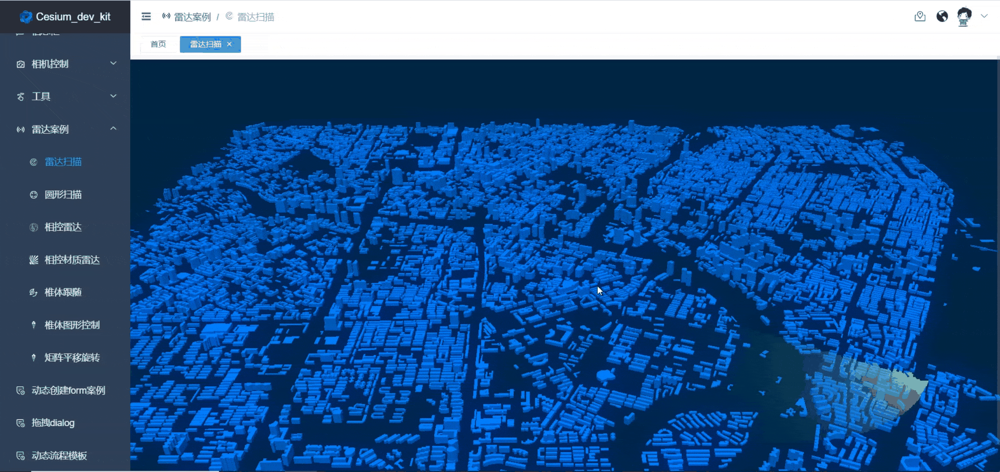
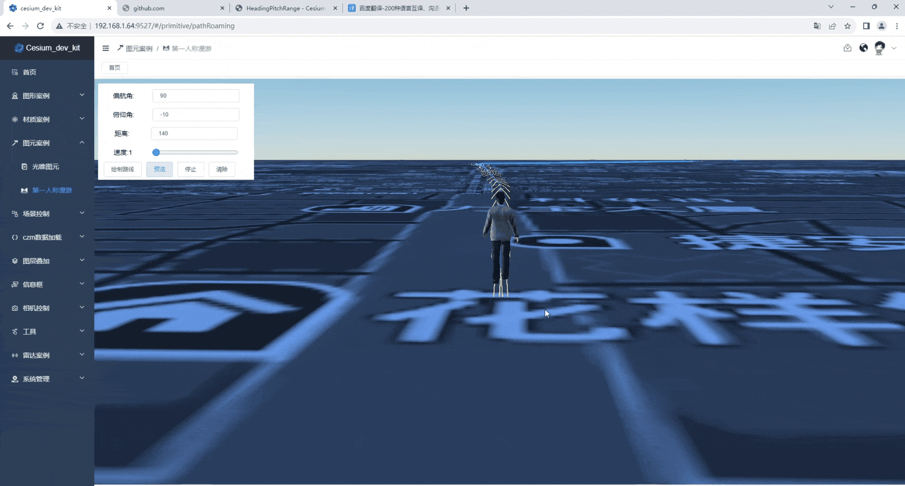
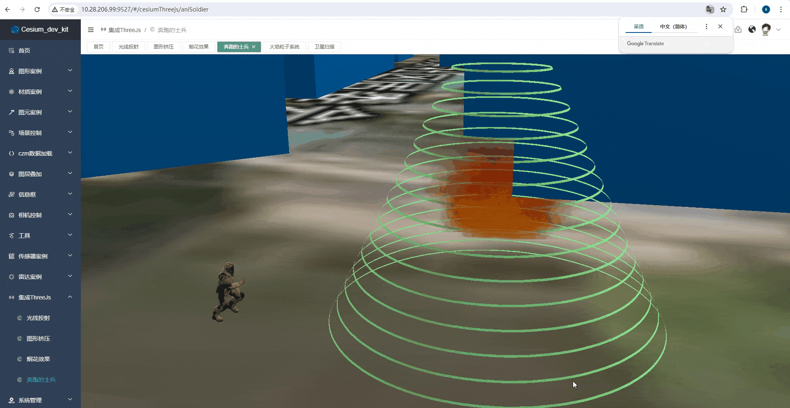
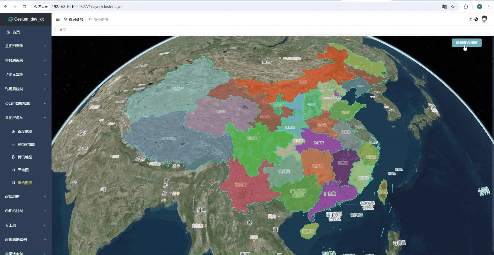
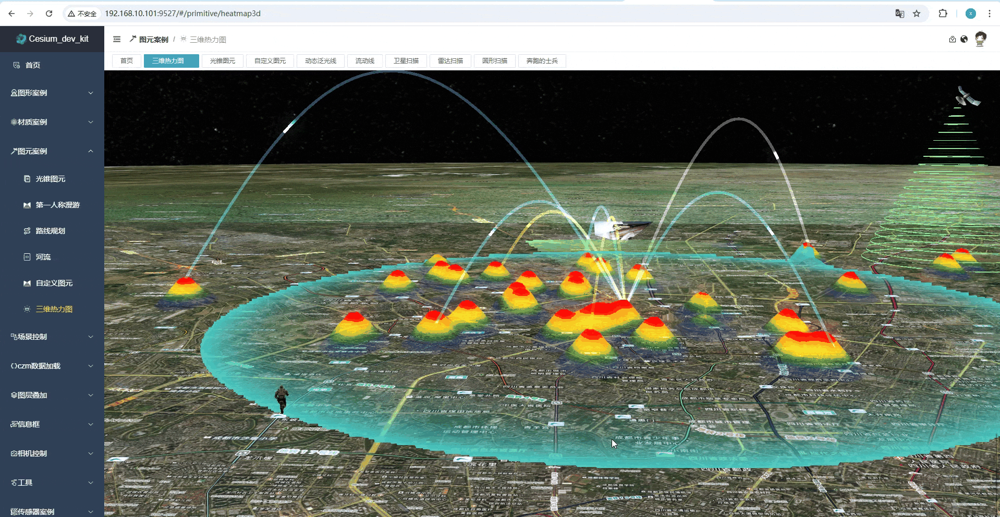

## cesium_dev_kit

[![Build Status][build-main]][build-status]
[![NPM Package][npm]][npm-url]
[![NPM Downloads][npm-download]][npmtrends-url]
[![Build Size][build-size]][build-size-url]
[![GitHub Repo stars][repo-stars]][star-chart]
[![license][license-uri]][license-link]

**English** | [中文](./README.zh-CN.md)

## Introduction

&emsp;This is a Cesium development kit that includes functionalities such as layer loading, coordinate conversion, coordinate picking, camera control, measurement, plotting, model loading and manipulation (translation, rotation scaling), 3Dtiles view position adjustment, weather effects (rain, snow, fog), scene rendering with radar scan and information box display capabilities. It also provides features for flow line visualization, lighting effects including dynamic wall and other luminous materials rendering.
Additionally it supports Post effects, visibility analysis tools for perspective analysis and slope analysis. Furthermore it offers Inundation analysis as well as volume analysis capabilities and terrain excavation functionality.

## API documentation & live demo

- API docs: [:bookmark_tabs: https://dengxiaoning.github.io/cesium_dev_kit/](https://dengxiaoning.github.io/cesium_dev_kit/)
- Live demo: [:rocket: https://dengxiaoning.github.io/cesium_dev_kit/demo/?auto=1](https://dengxiaoning.github.io/cesium_dev_kit/demo/?auto=1)

Both live on the same GitHub Pages site: docs at the root, the demo under `/demo/`. The demo logs
in with a mock account (`?auto=1`), and its sidebar lists every example, matching the classes in
the docs one by one.

The docs are generated from the JSDoc comments under `src/utils/cesiumPluginsExtends` (TypeDoc):

```bash
npm run docs             # build API docs into docs/
npm run build:demo:pages # build the demo into docs/demo/
npm run docs:serve       # local preview at http://localhost:5174
```

Pushing to `main` triggers `.github/workflows/docs.yml`, which builds both and deploys to GitHub Pages.

## Features

|      |                |                  |
| :-------------------------------------------------------------------------------------------------------------: | :-----------------------------------------------------------------------------------------------------------------------: | :-----------------------------------------------------------------------------------------------------------------: |
|                                                    terrainEdit                                                     |                                                         analysis                                                          |                                                        plot                                                         |
|  |                  |              |
|                                                  dynamicRiver                                                   |                                                          extrude                                                          |                                                       effect                                                        |
|            |                 |                  |
|                                                      radar                                                      |                                                          roaming                                                          |                                                        drag                                                         |
|        |  |      |
|                                                     rayCast                                                     |                                                      fireworksEffect                                                      |                                                     aniSoldier                                                      |
|      |    |  |
|                                                    pathPlan                                                     |                                                      customPrimitive                                                      |                                                    clusterLayer                                                     |
|            |          |        |
|                                                      bar3D                                                      |                                                        rollerBlind                                                        |                                                      heatmap3d                                                      |

[More>>](https://dengxiaoning.github.io/cesium_dev_kit/demo/?auto=1)

## Install

```shell
npm install cesium_dev_kit cesium
# optional: only needed for the Three.js integration
npm install three
```

> Requires Cesium `>=1.105`. `three`, `echarts`, `dat.gui` and `libgif` are optional peer dependencies (installed only when their features are used).
> The library no longer ships a Cesium Ion token. Pass your own token via
> `extraConfig.AccessToken` or set `Cesium.Ion.defaultAccessToken` before creating the viewer.

## Cesium static assets (required)

`cesium_dev_kit` draws on top of Cesium but does not ship Cesium's own runtime assets. Before the
first render, `Assets/`, `Workers/`, `ThirdParty/` and `Widgets/widgets.css` must be reachable —
otherwise you get a blank globe, missing terrain/imagery workers, or unstyled widgets.

**Vite (recommended)** — one plugin does the copying for you:

```bash
npm i -D vite-plugin-cesium
```

```ts
// vite.config.ts
import { defineConfig } from 'vite'
import cesium from 'vite-plugin-cesium'

export default defineConfig({ plugins: [cesium()] })
```

**Manual (webpack / Rspack / Rollup)**

1. Copy `node_modules/cesium/Build/Cesium/{Assets,Workers,ThirdParty,Widgets}` into your public
   directory, e.g. `public/cesium/`.
2. Point Cesium at it **before** Cesium is imported: `window.CESIUM_BASE_URL = '/cesium/'`.
3. Import the widget styles: `import 'cesium/Build/Cesium/Widgets/widgets.css'`.

Give the container an explicit size, or the canvas collapses to 0px:

```css
#cesiumContainer {
  width: 100%;
  height: 100%;
}
```

Also make sure `Cesium.Ion.defaultAccessToken` is set, or pass `extraConfig.AccessToken`.

## Quick start

### Import only what you need (recommended)

```ts
import * as Cesium from 'cesium'
import { Graphics } from 'cesium_dev_kit/graphics'

// Your own token, e.g. from an environment variable
Cesium.Ion.defaultAccessToken = import.meta.env.VITE_CESIUM_ION_TOKEN

const { viewer, graphics, dispose } = Graphics({
  cesiumGlobal: Cesium,
  containerId: 'cesiumContainer'
})

graphics.flyTo({
  position: { x: -1337132, y: 5330611, z: 3228680 }
})

// Call this when the page / route is unmounted
dispose()
```

Each subpath only bundles its own dependency graph. For example
`cesium_dev_kit/graphics` does not pull in `echarts` or `dat.gui`.
Available subpaths: `/graphics`, `/material`, `/primitive`, `/draw`, `/analysis`,
`/plugin`, `/pass-effect`, `/control`, `/three`, `/custom-cesium-plugin`,
`/default-static`.

### Default images and assets

Many helpers (sky box, point icon, light cone, water, analysis textures) fall
back to a small set of default images. If you do not pass `defaultStatic`, the
kit uses its built-in CDN config so that a fresh install works without 404s:

```ts
import { defaultStatic, createDefaultStatic } from 'cesium_dev_kit/default-static'

// 1. Use the built-in CDN (default)
// 2. Use your own CDN
const myStatic = createDefaultStatic('https://cdn.example.com/')
// 3. Use relative paths and self-host ./public/static from this repo
const localStatic = createDefaultStatic('')
```

### Import all modules

```ts
import * as Cesium from 'cesium'
import { initCesium } from 'cesium_dev_kit'

const kit = initCesium({
  cesiumGlobal: Cesium,
  containerId: 'cesiumContainer',
  extraConfig: { AccessToken: 'YOUR_CESIUM_ION_TOKEN' }
})

const { viewer, graphics, primitive, analysis } = kit
// ...

// Destroys the viewer created by the kit.
// If you passed an existing `viewer`, the kit will not destroy it.
kit.dispose()
```

### Recommended entry: `createKit`

`createKit` takes the same options as `initCesium` but returns an explicit context and has a clearer `dispose()` contract:

```ts
import * as Cesium from 'cesium'
import { createKit } from 'cesium_dev_kit'

const kit = createKit({
  Cesium,                     // `cesiumGlobal` also works
  containerId: 'cesiumContainer',
  assetsBaseUrl: '/static/',  // same as createDefaultStatic('/static/')
  extraConfig: { AccessToken: import.meta.env.VITE_CESIUM_ION_TOKEN },
  onError: (err, ctx) => console.warn(ctx?.scope, err)
})

kit.context.viewer // identical to kit.viewer
kit.graphics.createDynamicCircleGraphics({ /* ... */ })
kit.dispose() // idempotent; kit.isDisposed() reports the state
```

Contract:

- If the kit created the viewer, `dispose()` calls `viewer.destroy()`;
- If you passed your own viewer, `dispose()` only removes DataSources/listeners added by the kit and never destroys your viewer;
- Multiple kits can coexist on one page — modules no longer share module-level `Cesium` / `dfSt` state;
- The legacy `new initCesium({...})` form still works but is a compatibility entry; prefer `createKit` for new code.

### Error handling

Errors thrown by the library are `CesiumDevKitError` with a stable `code`:

```ts
import { isCesiumDevKitError, setErrorHandler } from 'cesium_dev_kit'

try {
  const kit = createKit({ Cesium, containerId: 'cesiumContainer' })
} catch (err) {
  if (isCesiumDevKitError(err) && err.code === 'MISSING_VIEWER') {
    // provide a container
  }
}

// Non-fatal errors caught internally default to console.warn
setErrorHandler((err, ctx) => console.warn(ctx?.scope, err))
```

Codes: `MISSING_CESIUM`, `MISSING_VIEWER`, `INVALID_ARGUMENT`, `IMAGERY_FAILED`,
`OPTIONAL_DEPENDENCY_MISSING`, `UNSUPPORTED_ENVIRONMENT`, `UNSUPPORTED_CESIUM_VERSION`, `INTERNAL`.

> Naming: `craete*` methods now have canonical `create*` names (e.g. `craeteDynamicCricleGraphics` →
> `createDynamicCircleGraphics`). The old names remain and are marked `@deprecated`.


### Script tag / no bundler

Current releases ship only ESM (`dist/*.mjs`) and CJS (`dist/*.cjs`) builds. `index.umd.js` and the
`window.cesium_dev_kit` global are **no longer published**, so the old
`<script src="index.umd.js">` snippet will 404. For a plain HTML page, bundle a small entry with
Vite in `iife` format:

```ts
// vite.config.ts
export default {
  build: {
    lib: { entry: 'src/main.ts', formats: ['iife'], name: 'demo' },
    rollupOptions: { output: { inlineDynamicImports: true } }
  }
}
```

Then load the generated file with a `<script>` tag. If you need an official UMD build back,
please open an issue.


## Three.js / Cesium fused rendering

By default Three.js renders into its own canvas stacked above the Cesium canvas via CSS. That has three drawbacks for ground-level content: the depth buffer is not shared (objects cannot sink into terrain), the camera matrix lags a frame (objects appear to float as you orbit), and you pay for an extra full-screen composite.

`fusion: 'single-context'` makes Three.js reuse Cesium's canvas and WebGL context, drawing directly into Cesium's frame against the same depth buffer:

```ts
import * as Cesium from 'cesium'
import * as THREE from 'three'
import { createKit } from 'cesium_dev_kit'

const kit = createKit({
  Cesium,
  three: THREE,
  containerId: 'cesiumContainer',
  threeContainerId: 'threeContainer',
  viewerConfig: {
    // fused mode requires WebGL2
    contextOptions: { requestWebgl2: true }
  }
})

const { scene, camera } = kit.threeJs.initThree({
  center: [104.08, 30.62],
  fusion: 'single-context', // default 'overlay' keeps the original two-canvas behaviour
  depth: 'canvas-blit',     // default when fusion is 'single-context'
  precision: 'double'       // default
})

// Only update your animation each frame; no need to call renderer.render yourself
kit.threeJs.loop(() => {
  mixer && mixer.update(0.016)
})
```

| Option | Default | Description |
| --- | --- | --- |
| `fusion` | `'overlay'` | `'single-context'` reuses Cesium's canvas and WebGL context; omit it to keep the two-canvas behaviour |
| `depth` | `'canvas-blit'` (single-context only) / `'none'` | Blits Cesium's depth onto the canvas so objects can be occluded by, and occlude, the terrain |
| `precision` | `'double'` | Composes the view matrix in float64 and drops precision once; `'legacy'` restores the old path |

Enabling it also does two things automatically: raises `scene.logarithmicDepthFarToNearRatio` to force a single frustum (multiple frustums clear depth between passes, leaving only the nearest slab), and skips the ECEF "fake occluder" spheres used by the old approach.

Caveats:

- WebGL2 is required. If the context is missing or not WebGL2, it logs the reason and falls back to two canvases without breaking rendering;
- With `scene.msaaSamples > 1`, `blitFramebuffer` may fail; repeated failures disable depth sharing (the context is still shared). Set `scene.msaaSamples = 1` on the Cesium side to avoid it;
- With OIT enabled the depth is not in a blit-able FBO, so it degrades to context sharing only;
- Do not call `renderer.setSize()` in fused mode: assigning canvas width/height clears the drawing buffer (and wipes Cesium's frame). Size is driven by Cesium's canvas.

To check whether occlusion is actually active, call `kit.threeJs.getFusionStatus()`; it reports frustum count, logarithmic depth, MSAA samples and the current depth source.

## Development

```shell
npm install
npm run dev          # demo site
npm run typecheck
npm test
npm run build:lib    # dist: ESM + CJS + .d.ts + sourcemaps
npm run build        # demo site
```

---

## Use example

- Vue Use case
  [https://github.com/dengxiaoning/cesium_kit_test](https://github.com/dengxiaoning/cesium_kit_test)

- React Use case
  [https://github.com/dengxiaoning/react-cesium](https://github.com/dengxiaoning/react-cesium)
- H5 Use case
  [https://github.com/dengxiaoning/cesium_kit_test_h5](https://github.com/dengxiaoning/cesium_kit_test_h5)

## Donate

Do you use and like cesium_dev_kit but you don’t find a way to show some love? If yes, please consider donating to support this project. Otherwise, no worries, regardless of whether there is support or not, I will keep maintaining this project. Still, if you buy me a cup of coffee I would be more than happy though😄

- [](https://paypal.me/xiaoningdeng?country.x=C2&locale.x=en_US)

- [GitHub Sponsors](https://github.com/sponsors/dengxiaoning)

##

## Browser support

The 'Chrome 80+' browser is recommended for local development

Modern browsers (chrome, Firefox, Microsoft edge, etc.) are supported. Internet Explorer is not supported

## Thanks

[cesium-d3kit](https://github.com/zhangti0708/cesium-d3kit)<br/>
[drawarrowforcesium](https://gitcode.net/mirrors/gitgitczl/drawarrowforcesium)<br/>
[vue3-ts-cesium-map-show](https://gitee.com/hawk86104/vue3-ts-cesium-map-show)<br/>

This project includes but is not limited to the reference and reference of the above materials, thank you very much for sharing

## Project deficiency and optimization

- 1、Cesium-related types are intentionally loose (`any`) to support CDN / global `window.Cesium` usage; precise types can be extended if you install cesium via npm
- 2、Errors are normalized as `CesiumDevKitError` with stable codes, and non-fatal ones go through `setErrorHandler` (see above); a few legacy helpers still swallow errors silently
- 3、Unit tests cover the pure algorithm layers (12 suites). Browser/DOM-level integration tests and a Cesium version matrix are still missing

## How to contribute

This project exists thanks to all the people who contribute.<br/>

<a href="https://github.com/dengxiaoning/cesium_dev_kit/graphs/contributors">

</a>

- If you want to contribute, you can [Raise an issue](https://github.com/dengxiaoning/cesium_dev_kit/issues/new) Or submit a Pull Request.

See [CONTRIBUTING](./CONTRIBUTING.md) for more details on donations...

---

## `Star`

I am grateful to the generous individuals who awarded me these little stars, thank you for your support :heart:

[See all stargazers](https://github.com/dengxiaoning/cesium_dev_kit/stargazers) · [Star history](https://api.star-history.com/svg?repos=dengxiaoning/cesium_dev_kit&type=Date)

## `Fork`

@sincely、`@ooil929`、 @InPanda、 `luyufanzhi`、AllenChiangCN、`Liquid-Zhangliquan`... thank you for your attention :heart:

[See all forks](https://github.com/dengxiaoning/cesium_dev_kit/network/members)

[npm]: https://img.shields.io/npm/v/cesium_dev_kit
[npm-url]: https://www.npmjs.com/package/cesium_dev_kit
[build-size]: https://img.shields.io/bundlephobia/minzip/cesium_dev_kit/1.0.70?logo=travis
[build-size-url]: https://img.shields.io/bundlephobia/minzip/cesium_dev_kit
[npm-download]: https://img.shields.io/npm/dy/cesium_dev_kit?logo=npm
[npmtrends-url]: https://www.npmtrends.com/cesium_dev_kit
[license-uri]: https://img.shields.io/npm/l/cesium_dev_kit.svg
[license-link]: https://npm.im/cesium_dev_kit
[build-status]: https://github.com/dengxiaoning/cesium_dev_kit
[build-main]: https://img.shields.io/github/actions/workflow/status/dengxiaoning/cesium_dev_kit/project-build.yml?branch=main&logo=github
[repo-stars]: https://img.shields.io/github/stars/dengxiaoning/cesium_dev_kit?style=plastic&logo=github
[star-chart]: https://api.star-history.com/svg?repos=dengxiaoning/cesium_dev_kit&type=Date
