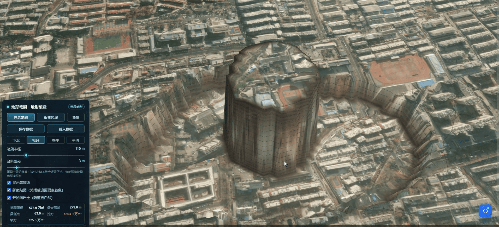
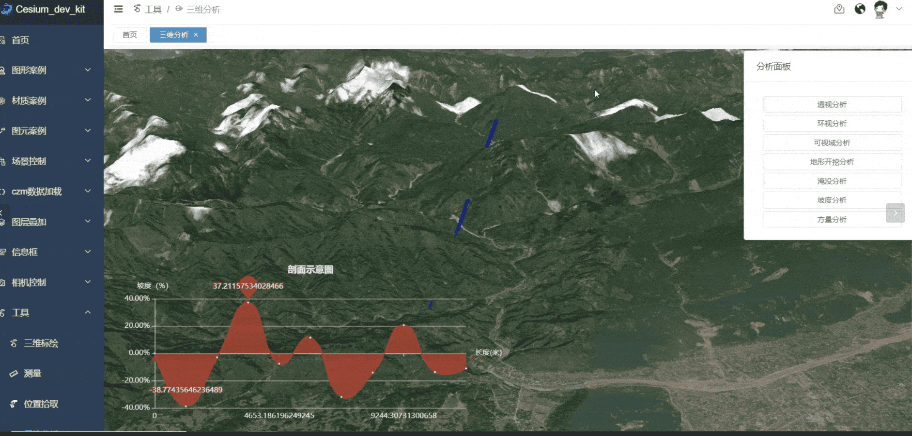
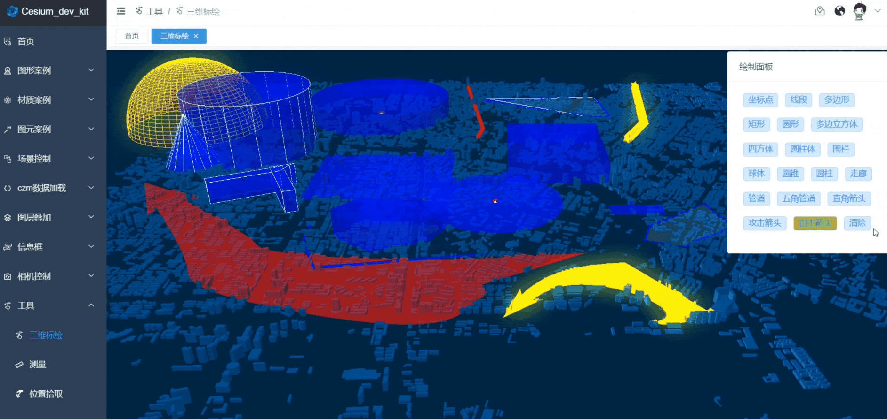
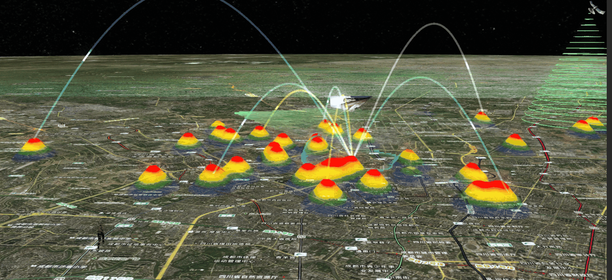
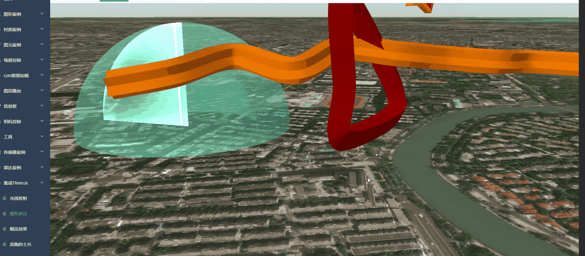
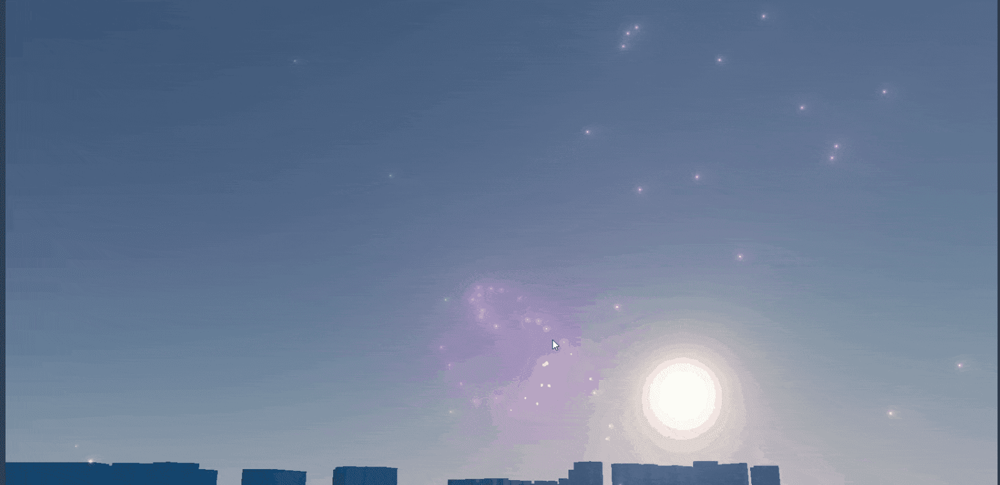
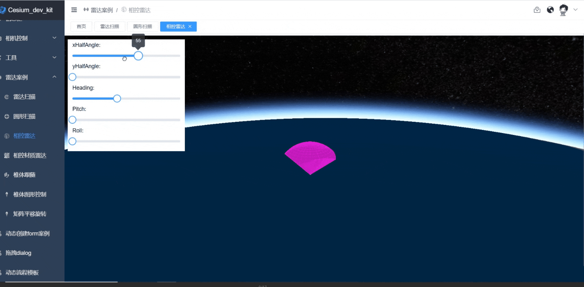
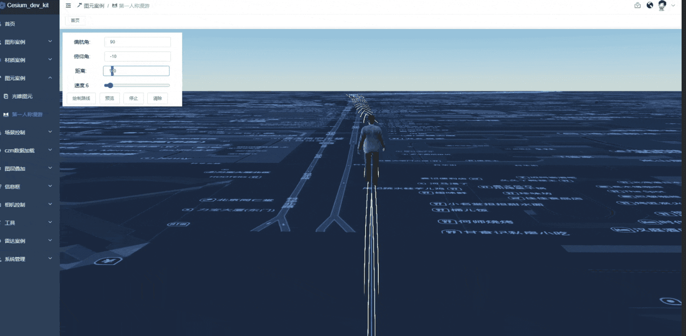
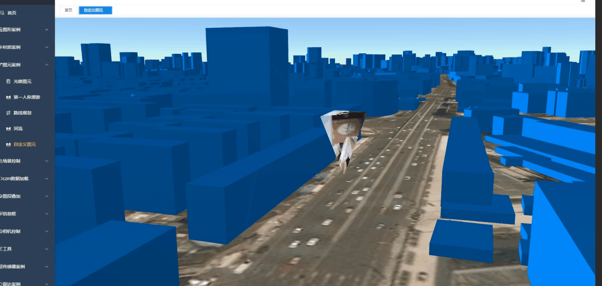

## cesium_dev_kit

[![Build Status][build-main]][build-status]
[![NPM Package][npm]][npm-url]
[![NPM 下载量][npm-download]][npmtrends-url]
[![Build Size][build-size]][build-size-url]
[![GitHub Repo stars][repo-stars]][star-chart]
[![license][license-uri]][license-link]

[English](./README.en.US.md) | **中文**

> 面向业务开发的 Cesium 工具包：标绘、量算、空间分析、自定义材质 / 图元、传感器、后处理特效、地形编辑，以及与 Three.js 的单上下文深度融合。按需引入，不绑定任何前端框架。



### 为什么选它

- **按需引入**：17 个子路径（`/graphics`、`/analysis`、`/three`……），用哪个装哪个，不会连带引入 `echarts` / `dat.gui`。
- **稀缺能力**：地形编辑（开挖 / 堆高 / 台阶 / 水面 / 土方统计）和 Three.js 单上下文深度融合（共享 Cesium 的 canvas 与深度缓冲），在 Cesium 生态里都不常见。
- **无框架绑定**：原生 API，React / Vue / 原生页面都能用；`createKit()` 生命周期清晰，`dispose()` 幂等。
- **可维护**：TypeScript 类型、稳定错误码、477 个 API、70+ 在线示例，文档与 Demo 一一对应。

### 30 秒上手

```bash
npm install cesium_dev_kit cesium
```

```ts
import * as Cesium from 'cesium'
import { createKit } from 'cesium_dev_kit'

const kit = createKit({
  Cesium,
  containerId: 'cesiumContainer'
})

kit.graphics.createPolygonGraphics({
  positions: Cesium.Cartesian3.fromDegreesArray([
    104.09, 30.65, 104.11, 30.65, 104.10, 30.63
  ]),
  material: Cesium.Color.RED.withAlpha(0.3),
  clampToGround: true
})

// 页面卸载时释放（幂等）
kit.dispose()
```

> 需要 Cesium `>=1.105`；`three`、`echarts`、`dat.gui`、`libgif` 均为可选 peer 依赖，只在使用对应功能时安装。
> 库内不再内置 Cesium Ion token，请通过 `extraConfig.AccessToken` 传入，或在应用入口设置 `Cesium.Ion.defaultAccessToken`。

**文档入口**：[API 文档](https://dengxiaoning.github.io/cesium_dev_kit/) ·
[示例大全（70+）](https://dengxiaoning.github.io/cesium_dev_kit/examples/) ·
[在线 Demo](https://dengxiaoning.github.io/cesium_dev_kit/demo/?auto=1) ·
[English](./README.en.US.md)

## API 文档与在线 Demo

- API 文档：[:bookmark_tabs: https://dengxiaoning.github.io/cesium_dev_kit/](https://dengxiaoning.github.io/cesium_dev_kit/)
- 示例大全：[:jigsaw: https://dengxiaoning.github.io/cesium_dev_kit/examples/](https://dengxiaoning.github.io/cesium_dev_kit/examples/)
- 在线 Demo：[:rocket: https://dengxiaoning.github.io/cesium_dev_kit/demo/?auto=1](https://dengxiaoning.github.io/cesium_dev_kit/demo/?auto=1)
- AI索引：[llms.txt](https://dengxiaoning.github.io/cesium_dev_kit/llms.txt) · [api-index.json](https://dengxiaoning.github.io/cesium_dev_kit/api-index.json)

三者同属一个 GitHub Pages 站点：文档在根路径，示例静态页在 `/examples/`，Demo 在 `/demo/`。
Demo 用模拟账号自动登录（`?auto=1`），左侧菜单就是全部示例，和文档里的类一一对应。

文档由 `src/utils/cesiumPluginsExtends` 下的 JSDoc 注释生成（TypeDoc）：

```bash
npm run docs             # 生成 API 文档到 docs/
npm run build:demo:pages # 把 Demo 构建到 docs/demo/
npm run docs:serve       # 本地预览 http://localhost:5174
```

推送到 `main` 后由 `.github/workflows/docs.yml` 依次构建文档与 Demo，并发布到 GitHub Pages。

## 功能展示

| |||
| :----------------------------------------------------: |:----------------------------------------------------:|:-------------------------------------: | 
|                地形编辑               |                         分析    |                                                   标绘   |
|  |   |  |
|                                    三维热力 |                 图形挤压         |           烟花      |
|| | |
|                雷达案例          |                            第一人称漫              |                  自定义图元          |

[更多示例（含源码）>>](https://dengxiaoning.github.io/cesium_dev_kit/examples/)

## 安装

主包只需要 Cesium；Three.js、ECharts、dat.gui、libgif 都是可选依赖：

```shell
npm install cesium_dev_kit cesium
npm install three   # 仅 Three.js 集成 / 地形编辑需要
```

> 需要 Cesium `>=1.105`。`three`、`echarts`、`dat.gui`、`libgif` 均为可选 peer 依赖（仅在使用对应功能时安装）。
> 库内不再内置 Cesium Ion token，请通过 `extraConfig.AccessToken` 传入，或在应用入口设置 `Cesium.Ion.defaultAccessToken`。

## Cesium 静态资源（必读）

`cesium_dev_kit` 只负责在 Cesium 之上扩展能力，**不包含 Cesium 自身的运行资源**。首次渲染前，
`Assets/`、`Workers/`、`ThirdParty/` 和 `Widgets/widgets.css` 必须可访问，否则会出现
地球不显示、地形/影像瓦片加载失败、控件没有样式等问题。

**Vite（推荐）**：用插件自动拷贝，不用手写配置。

```bash
npm i -D vite-plugin-cesium
```

```ts
// vite.config.ts
import { defineConfig } from 'vite'
import cesium from 'vite-plugin-cesium'

export default defineConfig({ plugins: [cesium()] })
```

**手动配置（webpack / Rspack / Rollup）**

1. 把 `node_modules/cesium/Build/Cesium/{Assets,Workers,ThirdParty,Widgets}` 拷到静态目录，例如 `public/cesium/`；
2. 在**引入 Cesium 之前**设置 `window.CESIUM_BASE_URL = '/cesium/'`；
3. 引入控件样式：`import 'cesium/Build/Cesium/Widgets/widgets.css'`。

容器必须给明确高度，否则画布高度为 0、页面一片空白：

```css
#cesiumContainer {
  width: 100%;
  height: 100%;
}
```

另外别忘了设置 `Cesium.Ion.defaultAccessToken`，或者通过 `extraConfig.AccessToken` 传入。

## 快速开始（推荐按需引入）

```ts
import * as Cesium from 'cesium'
import { Graphics } from 'cesium_dev_kit/graphics'

// 使用自己的 token，例如从环境变量读取
Cesium.Ion.defaultAccessToken = import.meta.env.VITE_CESIUM_ION_TOKEN

const { viewer, graphics, dispose } = Graphics({
  cesiumGlobal: Cesium,
  containerId: 'cesiumContainer'
})

// 页面 / 路由卸载时释放 kit 自己创建的 viewer
dispose()
```

`cesium_dev_kit/graphics` 不会连带引入 `echarts` / `dat.gui`。可用子路径：
`/graphics`、`/material`、`/primitive`、`/draw`、`/analysis`、`/plugin`、
`/pass-effect`、`/control`、`/three`、`/vue`、`/custom-cesium-plugin`、`/default-static`。

### 默认图片与静态资源

天空盒、点图标、光锥、水面、分析贴图等功能会用到一组默认图片。不传
`defaultStatic` 时，库会使用内置 CDN 配置，保证新项目安装后不会出现 404：

```ts
import { defaultStatic, createDefaultStatic } from 'cesium_dev_kit/default-static'

// 1. 使用内置 CDN（默认）
// 2. 换成自己的 CDN
const myStatic = createDefaultStatic('https://cdn.example.com/')
// 3. 使用相对路径，并把本仓库的 ./public/static 自托管到你的站点
const localStatic = createDefaultStatic('')
```

完整引入：

```ts
import { initCesium } from 'cesium_dev_kit'

const kit = initCesium({
  cesiumGlobal: Cesium,
  containerId: 'cesiumContainer',
  extraConfig: { AccessToken: 'YOUR_CESIUM_ION_TOKEN' }
})

// ...
kit.dispose()
```

### 推荐入口：createKit

`createKit` 与 `initCesium` 参数一致，但返回显式上下文，`dispose()` 的边界也更清楚：

```ts
import * as Cesium from 'cesium'
import { createKit } from 'cesium_dev_kit'

const kit = createKit({
  Cesium,                     // 也可以写 cesiumGlobal
  containerId: 'cesiumContainer',
  assetsBaseUrl: '/static/',  // 等价于 createDefaultStatic('/static/')
  extraConfig: { AccessToken: import.meta.env.VITE_CESIUM_ION_TOKEN },
  onError: (err, ctx) => console.warn(ctx?.scope, err) // 接管非致命错误
})

kit.context.viewer // 与 kit.viewer 相同
kit.graphics.createDynamicCircleGraphics({ /* ... */ })
kit.dispose() // 幂等；kit.isDisposed() 可查询状态
```

约定：

- viewer 由 kit 创建时，`dispose()` 会 `viewer.destroy()`；
- viewer 由调用方传入时，`dispose()` 只清理 kit 自己添加的 DataSource / 监听，不销毁 viewer；
- 同一页面可以创建多个 kit：模块内部不再共享模块级 `Cesium` / `dfSt` 状态；
- 旧写法 `new initCesium({...})` 仍然可用，但已标记为兼容入口，新代码建议用 `createKit`。

### 错误处理

库内主动抛出的错误统一为 `CesiumDevKitError`，带稳定的 `code`：

```ts
import { isCesiumDevKitError, setErrorHandler } from 'cesium_dev_kit'

try {
  const kit = createKit({ Cesium, containerId: 'cesiumContainer' })
} catch (err) {
  if (isCesiumDevKitError(err) && err.code === 'MISSING_VIEWER') {
    // 自己补一个容器
  }
}

// 库内被 catch 掉的非致命错误（销毁失败、可选依赖缺失等）默认 console.warn
setErrorHandler((err, ctx) => console.warn(ctx?.scope, err))
```

错误码：`MISSING_CESIUM`、`MISSING_VIEWER`、`INVALID_ARGUMENT`、`IMAGERY_FAILED`、
`OPTIONAL_DEPENDENCY_MISSING`、`UNSUPPORTED_ENVIRONMENT`、`UNSUPPORTED_CESIUM_VERSION`、`INTERNAL`。

> 命名修正：`craete*` 系列方法已提供正式名 `create*`（如 `craeteDynamicCricleGraphics` →
> `createDynamicCircleGraphics`），旧名保留并标记 `@deprecated`。


### 不用打包器 / script 标签直引

当前发布物只包含 ESM（`dist/*.mjs`）和 CJS（`dist/*.cjs`），**不再发布 `index.umd.js`**，
`window.cesium_dev_kit` 这个全局变量也随之取消 —— 老的
`<script src="index.umd.js">` 写法会 404。如果页面不能上打包器，用 Vite 打一个 `iife` 包再引：

```ts
// vite.config.ts
export default {
  build: {
    lib: { entry: 'src/main.ts', formats: ['iife'], name: 'demo' },
    rollupOptions: { output: { inlineDynamicImports: true } }
  }
}
```

生成的 js 用 `<script>` 引入即可。如果需要官方重新提供 UMD 构建，欢迎提 issue。

## Three.js 与 Cesium 融合渲染

默认情况下 Three.js 画在一张独立的 canvas 上，靠 CSS 叠在 Cesium 画布之上。贴地物体在这种方案下会暴露三个问题：深度不共享（埋不进地形）、相机矩阵滞后一帧（贴地物随视角上下漂浮）、多一层全屏合成。

`fusion: 'single-context'` 让 Three.js 复用 Cesium 的 canvas 与 WebGL 上下文，直接画进 Cesium 的帧里，并与 Cesium 共享同一份深度缓冲：

```ts
import * as Cesium from 'cesium'
import * as THREE from 'three'
import { createKit } from 'cesium_dev_kit'

const kit = createKit({
  Cesium,
  three: THREE,
  containerId: 'cesiumContainer',
  threeContainerId: 'threeContainer',
  viewerConfig: {
    // 融合模式需要 WebGL2
    contextOptions: { requestWebgl2: true }
  }
})

const { scene, camera } = kit.threeJs.initThree({
  center: [104.08, 30.62],
  fusion: 'single-context', // 默认 'overlay'，不传即保持原有双 canvas 行为
  depth: 'canvas-blit',     // single-context 下的默认值
  precision: 'double'       // 默认值
})

// 每帧只更新模型动画即可，不需要自己调用 renderer.render
kit.threeJs.loop(() => {
  mixer && mixer.update(0.016)
})
```

| 参数 | 默认值 | 说明 |
| --- | --- | --- |
| `fusion` | `'overlay'` | `'single-context'` 复用 Cesium 的 canvas 与 WebGL 上下文；不传则保持原有双 canvas 行为 |
| `depth` | `'canvas-blit'`（仅 single-context）/ `'none'` | 把 Cesium 的深度 blit 到画布，使物体能被地形遮挡、也能遮挡地形 |
| `precision` | `'double'` | 在 float64 中合成视图矩阵、只降一次精度；`'legacy'` 可还原旧实现 |

开启后会自动做两件事：把 `scene.logarithmicDepthFarToNearRatio` 抬到单视锥（多视锥会在帧之间清深度，导致帧末只剩最近一段有深度），并跳过旧方案里用于「伪造遮挡」的 ECEF 模拟球。

需要注意的边界：

- 需要 WebGL2。取不到上下文或上下文不是 WebGL2 时，会打印原因并自动回退到双 canvas，不会中断渲染；
- `scene.msaaSamples > 1` 时 `blitFramebuffer` 可能失败，连续失败会自动关闭深度共享（仍共享上下文）；可在 Cesium 侧设 `scene.msaaSamples = 1` 规避；
- 开启 OIT 后深度不在可搬运的 FBO 上，会自动降级为「仅共享上下文」；
- 融合模式不要调用 `renderer.setSize()`：给 canvas 宽高赋值会清空绘制缓冲（连带擦掉 Cesium 的画面），尺寸由 Cesium 的画布决定。

排查遮挡是否生效，用 `kit.threeJs.getFusionStatus()`，它会返回视锥数量、对数深度开关、MSAA 采样数与当前深度来源。

## Vue 组合式 API（适配器）

`cesium_dev_kit/vue` 提供一个 `useCesiumKit` 组合式函数，把 kit 的创建 / 销毁接到 Vue 组件生命周期上，省去手动 `onMounted` / `onUnmounted` 的样板代码：

```vue
<script setup lang="ts">
import * as Cesium from 'cesium'
import { useCesiumKit } from 'cesium_dev_kit/vue'

// 组件挂载时创建 kit，卸载时自动 dispose()
const { kit, viewer, ready, error } = useCesiumKit({
  Cesium,
  containerId: 'cesiumContainer'
})
</script>

<template>
  <div id="cesiumContainer" style="width:100%;height:100%"></div>
</template>
```

- `kit` / `viewer` 是 `shallowRef`（重量对象不做深层响应式）；
- `ready` 变 `true` 后再访问 `kit.value.graphics` 等模块；
- 需要多个组件共享同一个 viewer 时，用 `provideCesiumKit(kit)` / `useCesiumKitShared()`。
- `vue` 是可选 peer 依赖（`>=3.2`），不用 Vue 完全不受影响。

## React Hooks（适配器）

`cesium_dev_kit/react` 提供同款 `useCesiumKit` Hook，把 kit 的创建 / 销毁接到 React 组件生命周期上：

```tsx
import * as Cesium from 'cesium'
import { useCesiumKit } from 'cesium_dev_kit/react'

function Map() {
  const { kit, viewer, ready, error } = useCesiumKit({
    Cesium,
    containerId: 'cesiumContainer'
  })

  if (error) return <div>初始化失败：{error.message}</div>

  return <div id="cesiumContainer" style={{ width: '100%', height: '100%' }} />
}
```

- 挂载时创建 kit，卸载时自动 `dispose()`；
- `options` 只在挂载时读取一次，变化不会重建（如需重建请用 `key` 重新挂载）；
- 多个组件共享同一个 viewer 时，用 `<CesiumKitProvider value={kit}>` 包裹子组件，再在子组件里 `useCesiumKitShared()`；
- `react` 是可选 peer 依赖（`>=16.8`），不用 React 完全不受影响。

## 标注序列化与撤销 / 重做

`cesium_dev_kit/annotation` 把「标注数据」和「Cesium 渲染」拆成两层，数据层是纯逻辑、可脱离浏览器单测：

```ts
import * as Cesium from 'cesium'
import { AnnotationStore, AnnotationLayer } from 'cesium_dev_kit/annotation'

const store = new AnnotationStore()
const layer = new AnnotationLayer({ Cesium, viewer, store })

// 新增 / 修改 / 删除都会自动进入撤销栈
store.add({ type: 'point', positions: [[104.09, 30.65]], style: { color: '#ffcc00' } })
store.add({
  type: 'polyline',
  positions: [[104.09, 30.65], [104.11, 30.68]],
  style: { lineWidth: 3 }
})

store.undo() // 撤销上一步
store.redo() // 重做

// 持久化：导出为纯 JSON
const json = store.toJSON()
localStorage.setItem('annotations', JSON.stringify(json))

// 载入（可撤销）；初始化时可用 AnnotationStore.fromJSON（不产生撤销记录）
store.load(JSON.parse(localStorage.getItem('annotations')!))

// 不再需要时移除实体并取消订阅
layer.destroy()
```

- `AnnotationStore` 支持 `add / update / remove / clear / load / toJSON / fromJSON`，`style`、`meta` 更新为浅合并；
- 每次变更生成一条可撤销命令，`undo()` / `redo()` 与 `canUndo` / `canRedo` 可直接驱动工具栏按钮；
- `AnnotationLayer` 把 store 变化 diff 成 Cesium entity，变更的标注采用「删掉重建」，避开属性更新 API 的兼容问题；
- 需要更细粒度的命令控制时，可单独使用 `cesium_dev_kit/history` 的 `CommandHistory`。

标绘（攻击 / 钳击 / 直线箭头）也支持同样的序列化 + 撤销，走 `cesium_dev_kit/plot`：

```ts
import * as Cesium from 'cesium'
import { PlotStore, PlotLayer } from 'cesium_dev_kit/plot'

const store = new PlotStore()
const layer = new PlotLayer({ Cesium, viewer, store })

store.add({
  type: 'AttackArrow',
  positions: [[104.09, 30.65], [104.11, 30.68], [104.10, 30.70]],
  fillMaterial: '#ff5252'
})

store.undo()              // 撤销
const json = store.toJSON() // 持久化（控制点 + 类型 + 填充色）
store.load(json)          // 载入（可撤销）
layer.destroy()
```

- `PlotStore` 数据层校验类型与控制点数量（三种箭头均需 ≥3 个点），`PlotLayer` 复用标绘自身的 `createByData` 还原图形；
- 删除 / 变更时彻底销毁 handler 与 tooltip，避免交互监听器累积。

## 框架无关绘制工具条（Web Components）

`cesium_dev_kit/web-components` 提供 `<cesium-draw-toolbar>` 自定义元素，不依赖 React / Vue：

```ts
import { defineDrawToolbar, bindDrawToolbar } from 'cesium_dev_kit/web-components'

defineDrawToolbar() // 注册 <cesium-draw-toolbar>

bindDrawToolbar(document.querySelector('cesium-draw-toolbar')!, {
  point: () => draw.drawPointGraphics(),
  polyline: () => draw.drawLineGraphics(),
  polygon: () => draw.drawPolygonGraphics(),
  cancel: () => draw.cancelDraw?.()
})
```

```html
<cesium-draw-toolbar modes="point,polyline,polygon,rectangle,circle"></cesium-draw-toolbar>
```

- 选中模式时派发 `cesium-draw` 事件，`event.detail.mode` 为模式名（点「取消」时为 `null`）；
- `value` 属性用于回显当前激活模式；
- 对 SSR 安全：Node 中 import 不会因 `HTMLElement` 未定义而报错，`defineDrawToolbar()` 只在浏览器真正注册。

## 剖面分析

`kit.analysis.createProfileAnalysis` 沿一条线采样地形，输出高程剖面图与统计（最高 / 最低 / 平均 / 累计爬升下降）：

```ts
kit.analysis.createProfileAnalysis({
  positions: [[104.09, 30.65], [104.11, 30.68]], // 省略则在地图上交互画线
  samples: 200,
  callback: (result) => {
    console.log(result.stats) // { minHeight, maxHeight, avgHeight, gain, loss, ... }
    console.log(result.samples) // [{ distance, height, lng, lat }, ...]
    // result.remove() 可关闭剖面图
  }
})
```

纯计算部分（`computeProfileStats` / `buildProfileChartData` / `interpolateLngLat`）从 `cesium_dev_kit/analysis` 导出，可脱离 viewer 单测或自行渲染图表。

## 教程

- [快速上手：10 分钟画出第一个三维场景](./guides/getting-started.zh.md)
- [地形编辑实战：开挖基坑并导出 / 载入](./guides/terrain-editing.zh.md)
- [Cesium + Three.js 单上下文融合](./guides/cesium-three-fusion.zh.md)

（英文版见 [`guides/*.en.md`](./guides/)）

## 部署

```shell
npm install
npm run dev          # 查看案例
npm run typecheck
npm test
npm run build:lib    # 将插件打包，其中包含 ESM + CJS + .d.ts + 源码
npm run build        # 查看案例 
```

---

## 使用范例

- ES6 使用案例
  [https://github.com/dengxiaoning/cesium_kit_test](https://github.com/dengxiaoning/cesium_kit_test)

- React Use case
  [https://github.com/dengxiaoning/react-cesium](https://github.com/dengxiaoning/react-cesium)
- H5 使用案例
  [https://github.com/dengxiaoning/cesium_kit_test_h5](https://github.com/dengxiaoning/cesium_kit_test_h5)

## 捐赠

你是否使用并喜欢 cesium_dev_kit，但你没有找到一种方式来表达你的喜欢? 如果是，请考虑捐款来支持这个项目。或许不是也不用担心，不管有没有支持，我都会继续维护这个项目。不过，如果你请我喝杯咖啡，我会非常高兴 😄

- [](https://paypal.me/xiaoningdeng?country.x=C2&locale.x=en_US)

- [GitHub Sponsors](https://github.com/sponsors/dengxiaoning)

##

## 浏览器支持

本地开发推荐使用`Chrome 80+` 浏览器

支持现代（chrome，Firefox，Microsoft edge，etc.）浏览器, 不支持 IE

## 鸣谢

[cesium-d3kit](https://github.com/zhangti0708/cesium-d3kit)<br/>
[drawarrowforcesium](https://gitcode.net/mirrors/gitgitczl/drawarrowforcesium)<br/>
[vue3-ts-cesium-map-show](https://gitee.com/hawk86104/vue3-ts-cesium-map-show)<br/>

本项目包括但不限于借鉴和参考以上资料，非常感谢作者分享

## 项目不足与优化

- 1、错误已统一为 `CesiumDevKitError`（稳定 code），非致命错误走 `setErrorHandler`；少数旧工具方法仍会静默吞掉异常
- 2、单元测试覆盖纯算法层（12 个套件），浏览器 / DOM 级集成测试与 Cesium 版本矩阵仍缺失

## 如何贡献

<a href="https://github.com/dengxiaoning/cesium_dev_kit/graphs/contributors">
  
</a>

你可以[提一个 issue](https://github.com/dengxiaoning/cesium_dev_kit/issues/new) 或者提交一个 Pull Request。

更多贡献详情见[CONTRIBUTING](./CONTRIBUTING.md)...

---

## `Star`

非常感谢留下星星的好心人，感谢您的支持 :heart:

[查看全部 Stargazers](https://github.com/dengxiaoning/cesium_dev_kit/stargazers) · [Star 增长曲线](https://api.star-history.com/svg?repos=dengxiaoning/cesium_dev_kit&type=Date)

## `Fork`

@sincely、`@ooil929`、 @InPanda、 `luyufanzhi`、AllenChiangCN、`Liquid-Zhangliquan` :heart:

[查看全部 Fork](https://github.com/dengxiaoning/cesium_dev_kit/network/members)

[npm]: https://img.shields.io/npm/v/cesium_dev_kit
[npm-url]: https://www.npmjs.com/package/cesium_dev_kit
[build-size]: https://img.shields.io/bundlephobia/minzip/cesium_dev_kit/1.0.70?logo=travis
[build-size-url]: https://img.shields.io/bundlephobia/minzip/cesium_dev_kit
[npm-download]: https://img.shields.io/npm/dy/cesium_dev_kit?logo=npm
[npmtrends-url]: https://www.npmtrends.com/cesium_dev_kit
[license-uri]: https://img.shields.io/npm/l/cesium_dev_kit.svg
[license-link]: https://npm.im/cesium_dev_kit
[build-status]: https://github.com/dengxiaoning/cesium_dev_kit
[build-main]: https://img.shields.io/github/actions/workflow/status/dengxiaoning/cesium_dev_kit/project-build.yml?branch=main&logo=github
[repo-stars]: https://img.shields.io/github/stars/dengxiaoning/cesium_dev_kit?style=plastic&logo=github
[star-chart]: https://api.star-history.com/svg?repos=dengxiaoning/cesium_dev_kit&type=Date
