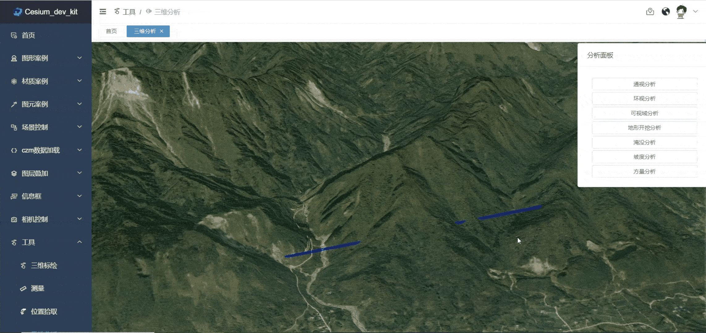
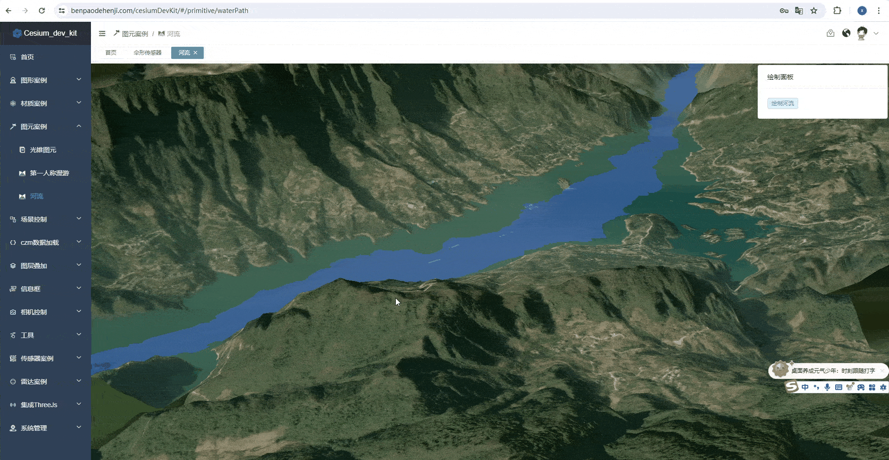
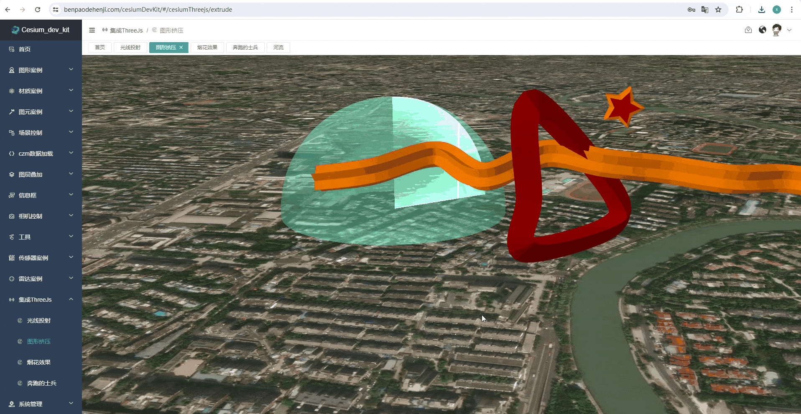
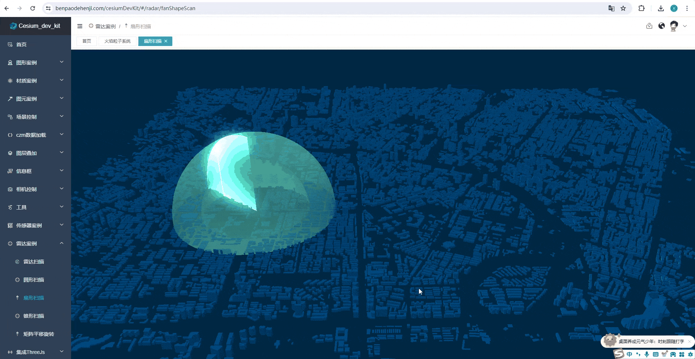

## cesium_dev_kit

[![Build Status][build-main]][build-status]
[![NPM Package][npm]][npm-url]
[![NPM DownloadsWeekly][npm-download]][npmtrends-url]
[![Build Size][build-size]][build-size-url]
[![GitHub Repo stars][repo-stars]][star-chart]
[![license][license-uri]][license-link]

**English** | [中文](./README.zh-CN.md)

## Introduction

&emsp;This is a Cesium development kit that includes functionalities such as layer loading, coordinate conversion, coordinate picking, camera control, measurement, plotting, model loading and manipulation (translation, rotation scaling), 3Dtiles view position adjustment, weather effects (rain, snow, fog), scene rendering with radar scan and information box display capabilities. It also provides features for flow line visualization, lighting effects including dynamic wall and other luminous materials rendering.
Additionally it supports Post effects, visibility analysis tools for perspective analysis and slope analysis. Furthermore it offers Inundation analysis as well as volume analysis capabilities and terrain excavation functionality.

## API documentation

See [:bookmark_tabs: https://dengxiaoning.github.io/cesium_dev_kit/](https://dengxiaoning.github.io/cesium_dev_kit/)

The docs are generated from the JSDoc comments under `src/utils/cesiumPluginsExtends` (TypeDoc):

```bash
npm run docs        # output to docs/
npm run docs:serve  # local preview at http://localhost:5174
```

Pushing to `main` triggers `.github/workflows/docs.yml`, which builds and deploys to GitHub Pages.

## Features

|      |                |                  |
| :-------------------------------------------------------------------------------------------------------------: | :-----------------------------------------------------------------------------------------------------------------------: | :-----------------------------------------------------------------------------------------------------------------: |
|                                                    material                                                     |                                                         analysis                                                          |                                                        plot                                                         |
|  |                  |              |
|                                                  dynamicRiver                                                   |                                                          extrude                                                          |                                                       effect                                                        |
|            |                 |                  |
|                                                      radar                                                      |                                                          roaming                                                          |                                                        drag                                                         |
|        |  |      |
|                                                     rayCast                                                     |                                                      fireworksEffect                                                      |                                                     aniSoldier                                                      |
|      |    |  |
|                                                    pathPlan                                                     |                                                      customPrimitive                                                      |                                                    clusterLayer                                                     |
|            |          |        |
|                                                      bar3D                                                      |                                                        rollerBlind                                                        |                                                      heatmap3d                                                      |

[More>>](https://benpaodehenji.com/cesiumDevKit)

## Install

```shell
npm install cesium_dev_kit cesium
# optional: only needed for the Three.js integration
npm install three
```

> Requires Cesium `>=1.105`. `three`, `echarts`, `dat.gui` and `libgif` are optional peer dependencies (installed only when their features are used).
> The library no longer ships a Cesium Ion token. Pass your own token via
> `extraConfig.AccessToken` or set `Cesium.Ion.defaultAccessToken` before creating the viewer.

## Quick start

### Import only what you need (recommended)

```ts
import * as Cesium from 'cesium'
import { Graphics } from 'cesium_dev_kit/graphics'

// Your own token, e.g. from an environment variable
Cesium.Ion.defaultAccessToken = import.meta.env.VITE_CESIUM_ION_TOKEN

const { viewer, graphics, dispose } = Graphics({
  cesiumGlobal: Cesium,
  containerId: 'cesiumContainer'
})

graphics.flyTo({
  position: { x: -1337132, y: 5330611, z: 3228680 }
})

// Call this when the page / route is unmounted
dispose()
```

Each subpath only bundles its own dependency graph. For example
`cesium_dev_kit/graphics` does not pull in `echarts` or `dat.gui`.
Available subpaths: `/graphics`, `/material`, `/primitive`, `/draw`, `/analysis`,
`/plugin`, `/pass-effect`, `/control`, `/three`, `/custom-cesium-plugin`,
`/default-static`.

### Default images and assets

Many helpers (sky box, point icon, light cone, water, analysis textures) fall
back to a small set of default images. If you do not pass `defaultStatic`, the
kit uses its built-in CDN config so that a fresh install works without 404s:

```ts
import { defaultStatic, createDefaultStatic } from 'cesium_dev_kit/default-static'

// 1. Use the built-in CDN (default)
// 2. Use your own CDN
const myStatic = createDefaultStatic('https://cdn.example.com/')
// 3. Use relative paths and self-host ./public/static from this repo
const localStatic = createDefaultStatic('')
```

### Import all modules

```ts
import * as Cesium from 'cesium'
import { initCesium } from 'cesium_dev_kit'

const kit = initCesium({
  cesiumGlobal: Cesium,
  containerId: 'cesiumContainer',
  extraConfig: { AccessToken: 'YOUR_CESIUM_ION_TOKEN' }
})

const { viewer, graphics, primitive, analysis } = kit
// ...

// Destroys the viewer created by the kit.
// If you passed an existing `viewer`, the kit will not destroy it.
kit.dispose()
```

### Recommended entry: `createKit`

`createKit` takes the same options as `initCesium` but returns an explicit context and has a clearer `dispose()` contract:

```ts
import * as Cesium from 'cesium'
import { createKit } from 'cesium_dev_kit'

const kit = createKit({
  Cesium,                     // `cesiumGlobal` also works
  containerId: 'cesiumContainer',
  assetsBaseUrl: '/static/',  // same as createDefaultStatic('/static/')
  extraConfig: { AccessToken: import.meta.env.VITE_CESIUM_ION_TOKEN },
  onError: (err, ctx) => console.warn(ctx?.scope, err)
})

kit.context.viewer // identical to kit.viewer
kit.graphics.createDynamicCircleGraphics({ /* ... */ })
kit.dispose() // idempotent; kit.isDisposed() reports the state
```

Contract:

- If the kit created the viewer, `dispose()` calls `viewer.destroy()`;
- If you passed your own viewer, `dispose()` only removes DataSources/listeners added by the kit and never destroys your viewer;
- Multiple kits can coexist on one page — modules no longer share module-level `Cesium` / `dfSt` state;
- The legacy `new initCesium({...})` form still works but is a compatibility entry; prefer `createKit` for new code.

### Error handling

Errors thrown by the library are `CesiumDevKitError` with a stable `code`:

```ts
import { isCesiumDevKitError, setErrorHandler } from 'cesium_dev_kit'

try {
  const kit = createKit({ Cesium, containerId: 'cesiumContainer' })
} catch (err) {
  if (isCesiumDevKitError(err) && err.code === 'MISSING_VIEWER') {
    // provide a container
  }
}

// Non-fatal errors caught internally default to console.warn
setErrorHandler((err, ctx) => console.warn(ctx?.scope, err))
```

Codes: `MISSING_CESIUM`, `MISSING_VIEWER`, `INVALID_ARGUMENT`, `IMAGERY_FAILED`,
`OPTIONAL_DEPENDENCY_MISSING`, `UNSUPPORTED_ENVIRONMENT`, `UNSUPPORTED_CESIUM_VERSION`, `INTERNAL`.

> Naming: `craete*` methods now have canonical `create*` names (e.g. `craeteDynamicCricleGraphics` →
> `createDynamicCircleGraphics`). The old names remain and are marked `@deprecated`.


### Used in h5

- Import index.umd.js directly into html

```javaScript
<script type="text/javascript" src="index.umd.js"></script>
```

- Initialize object

```javaScript
new cesium_dev_kit.initCesium({...})
```


## Development

```shell
npm install
npm run dev          # demo site
npm run typecheck
npm test
npm run build:lib    # dist: ESM + CJS + .d.ts + sourcemaps
npm run build        # demo site
```

---

## Use example

- Vue Use case
  [https://github.com/dengxiaoning/cesium_kit_test](https://github.com/dengxiaoning/cesium_kit_test)

- React Use case
  [https://github.com/dengxiaoning/react-cesium](https://github.com/dengxiaoning/react-cesium)
- H5 Use case
  [https://github.com/dengxiaoning/cesium_kit_test_h5](https://github.com/dengxiaoning/cesium_kit_test_h5)

## Donate

Do you use and like cesium_dev_kit but you don’t find a way to show some love? If yes, please consider donating to support this project. Otherwise, no worries, regardless of whether there is support or not, I will keep maintaining this project. Still, if you buy me a cup of coffee I would be more than happy though😄

- [](https://paypal.me/xiaoningdeng?country.x=C2&locale.x=en_US)

- WeChat / AliPay
  <div style="display: flex">
    
    
  </div>

##

## Browser support

The 'Chrome 80+' browser is recommended for local development

Modern browsers (chrome, Firefox, Microsoft edge, etc.) are supported. Internet Explorer is not supported

## Thanks

[cesium-d3kit](https://github.com/zhangti0708/cesium-d3kit)<br/>
[drawarrowforcesium](https://gitcode.net/mirrors/gitgitczl/drawarrowforcesium)<br/>
[vue3-ts-cesium-map-show](https://gitee.com/hawk86104/vue3-ts-cesium-map-show)<br/>

This project includes but is not limited to the reference and reference of the above materials, thank you very much for sharing

## Project deficiency and optimization

- 1、Cesium-related types are intentionally loose (`any`) to support CDN / global `window.Cesium` usage; precise types can be extended if you install cesium via npm
- 2、No exception catching and handling
- 3、Missing unit tests and automated release pipeline

## How to contribute

This project exists thanks to all the people who contribute.<br/>

<a href="https://github.com/dengxiaoning/cesium_dev_kit/graphs/contributors">

</a>

- If you want to contribute, you can [Raise an issue](https://github.com/dengxiaoning/cesium_dev_kit/issues/new) Or submit a Pull Request.

See [CONTRIBUTING](./CONTRIBUTING.md) for more details on donations...

---

## `Star`

I am grateful to the generous individuals who awarded me these little stars, thank you for your support :heart:

[![Stargazers repo roster for @dengxiaoning/cesium_dev_kit][stargazers-url]][stargazers-link]

## `Fork`

@sincely、`@ooil929`、 @InPanda、 `luyufanzhi`、AllenChiangCN、`Liquid-Zhangliquan`... thank you for your attention :heart:

[![Forkers repo roster for @dengxiaoning/cesium_dev_kit][forkers-url]][forkers-link]

[npm]: https://img.shields.io/npm/v/cesium_dev_kit
[npm-url]: https://www.npmjs.com/package/cesium_dev_kit
[build-size]: https://img.shields.io/bundlephobia/minzip/cesium_dev_kit/1.0.70?logo=travis
[build-size-url]: https://img.shields.io/bundlephobia/minzip/cesium_dev_kit
[npm-download]: https://img.shields.io/npm/dy/cesium_dev_kit?logo=npm
[npmtrends-url]: https://www.npmtrends.com/cesium_dev_kit
[license-uri]: https://img.shields.io/npm/l/cesium_dev_kit.svg
[license-link]: https://npm.im/cesium_dev_kit
[build-status]: https://github.com/dengxiaoning/cesium_dev_kit
[build-main]: https://img.shields.io/github/actions/workflow/status/dengxiaoning/cesium_dev_kit/project-build.yml?branch=main&logo=github
[repo-stars]: https://img.shields.io/github/stars/dengxiaoning/cesium_dev_kit?style=plastic&logo=github
[forkers-url]: https://bytecrank.com/nastyox/reporoster/php/forkersSVG.php?user=dengxiaoning&repo=cesium_dev_kit
[forkers-link]: https://github.com/dengxiaoning/cesium_dev_kit/network/members
[stargazers-url]: https://bytecrank.com/nastyox/reporoster/php/stargazersSVG.php?user=dengxiaoning&repo=cesium_dev_kit
[stargazers-link]: https://github.com/dengxiaoning/cesium_dev_kit/stargazers
[star-chart]: https://api.star-history.com/svg?repos=dengxiaoning/cesium_dev_kit&type=Date
