## cesium_dev_kit

[![Build Status][build-main]][build-status]
[![NPM Package][npm]][npm-url]
[![NPM 下载量][npm-download]][npmtrends-url]
[![Build Size][build-size]][build-size-url]
[![GitHub Repo stars][repo-stars]][star-chart]
[![license][license-uri]][license-link]

[English](./README.md) | **中文**

## 简介

这是一个 Cesium 开发工具包，包含图层加载、坐标转换、坐标拾取、相机控制、测量、标绘、模型加载、模型平移旋转缩放、模型/3Dtiles 视角位置调整、模型拖拽、天气（雨，雪，雾）场景、雷达扫描、信息框、流动线、发光线、动态墙等各种发光材质、后置场景效果、通视分析、透视分析、坡度分析、淹没分析、方量分析、地形开挖等各种分析案例。

## API 文档与在线 Demo

- API 文档：[:bookmark_tabs: https://dengxiaoning.github.io/cesium_dev_kit/](https://dengxiaoning.github.io/cesium_dev_kit/)
- 在线 Demo：[:rocket: https://dengxiaoning.github.io/cesium_dev_kit/demo/?auto=1](https://dengxiaoning.github.io/cesium_dev_kit/demo/?auto=1)

两者同属一个 GitHub Pages 站点：文档在根路径，Demo 在 `/demo/`。Demo 用模拟账号自动登录
（`?auto=1`），左侧菜单就是全部示例，和文档里的类一一对应。

文档由 `src/utils/cesiumPluginsExtends` 下的 JSDoc 注释生成（TypeDoc）：

```bash
npm run docs             # 生成 API 文档到 docs/
npm run build:demo:pages # 把 Demo 构建到 docs/demo/
npm run docs:serve       # 本地预览 http://localhost:5174
```

推送到 `main` 后由 `.github/workflows/docs.yml` 依次构建文档与 Demo，并发布到 GitHub Pages。

## 功能展示

| 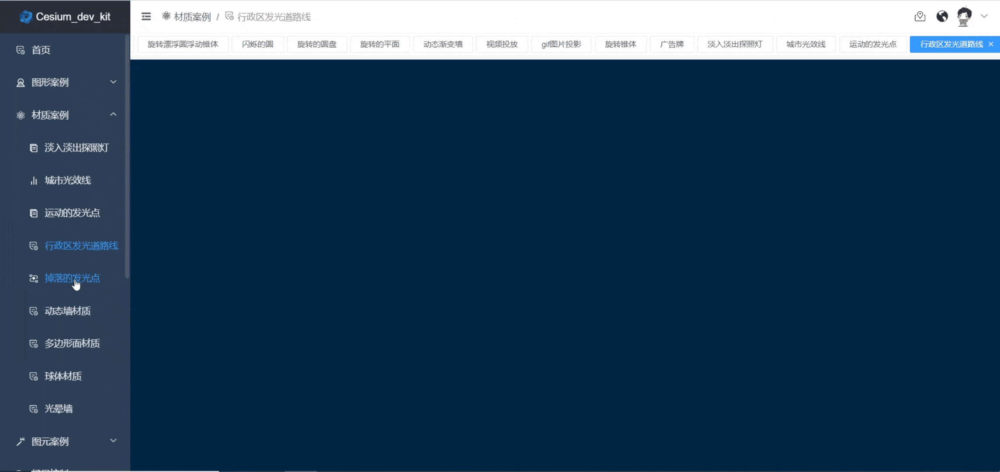 |        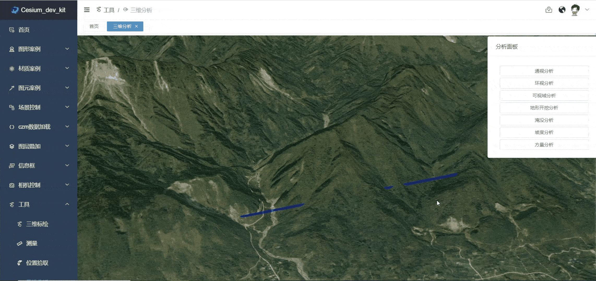        |       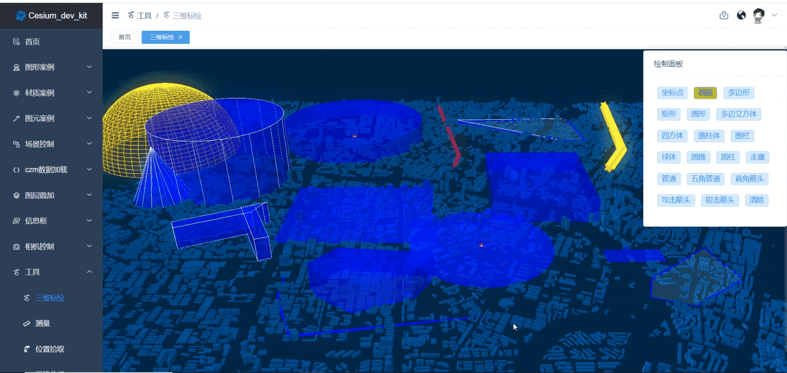       |
| :---------------------------------------------------------------------------------------------------------: | :-----------------------------------------------------------------------------------------------------------------------: | :-------------------------------------------------------------------------------------------------------------: |
|                                                    材质                                                     |                                                           分析                                                            |                                                      标绘                                                       |
| 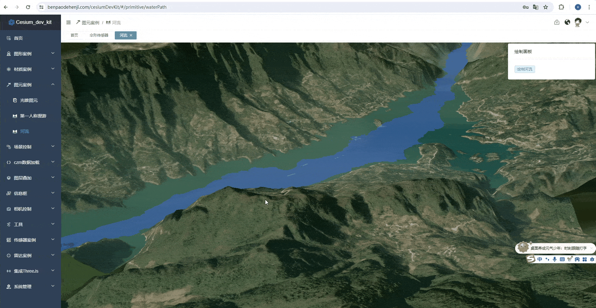 |         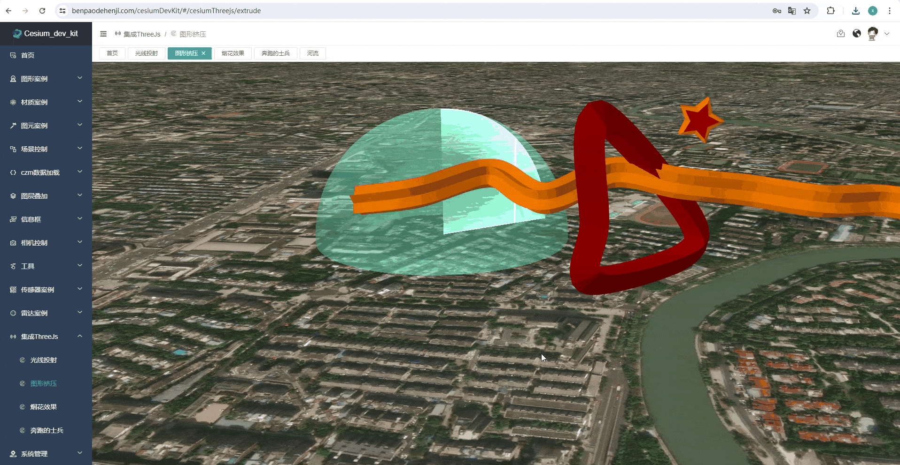         |     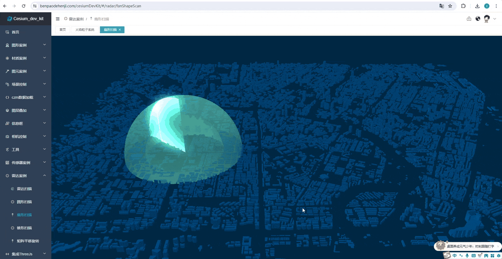     |
|                                                    河流                                                     |                                                         图形挤压                                                          |                                                      特效                                                       |
|    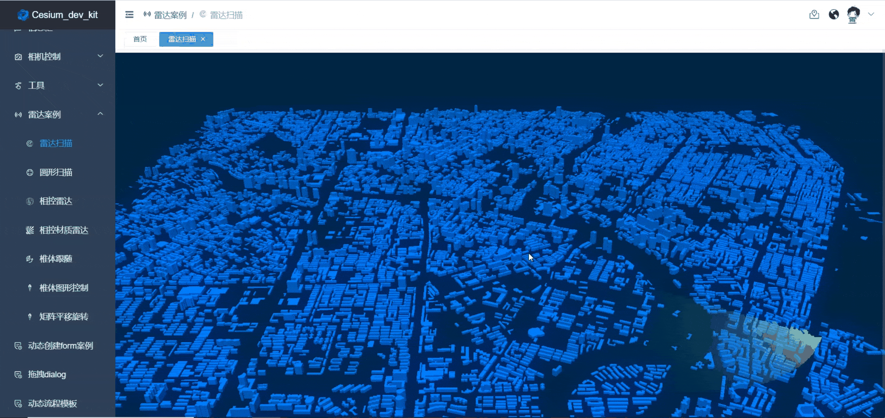    |        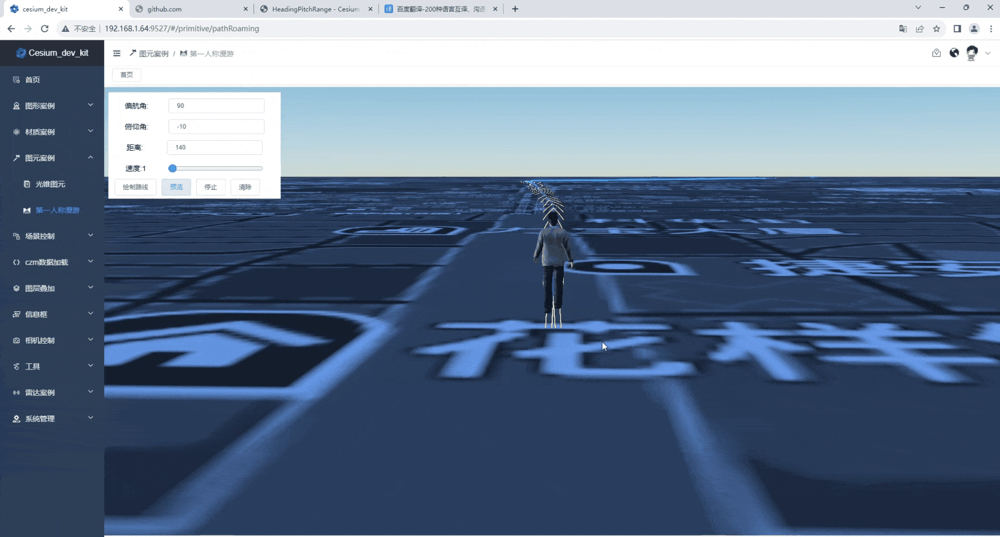         |              |
|                                                  雷达案例                                                   |                                                       第一人称漫游                                                        |                                                      拖拽                                                       |
|    | 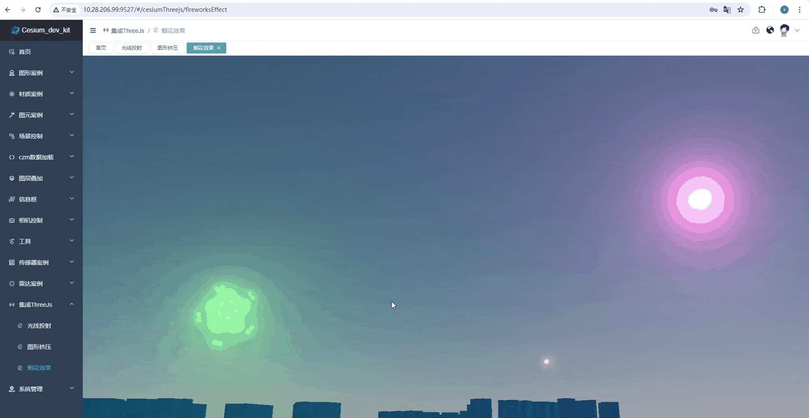 | 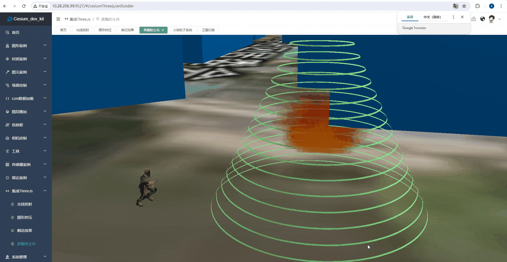 |
|                                                  光线投射                                                   |                                                         烟花效果                                                          |                                                   奔跑的士兵                                                    |
|  |         | 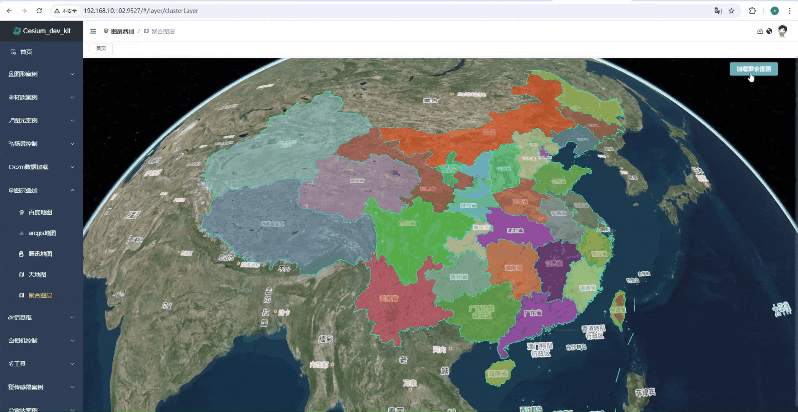 |
|                                                  路线规划                                                   |                                                        自定义图元                                                         |                                                    聚合图层                                                     |
|  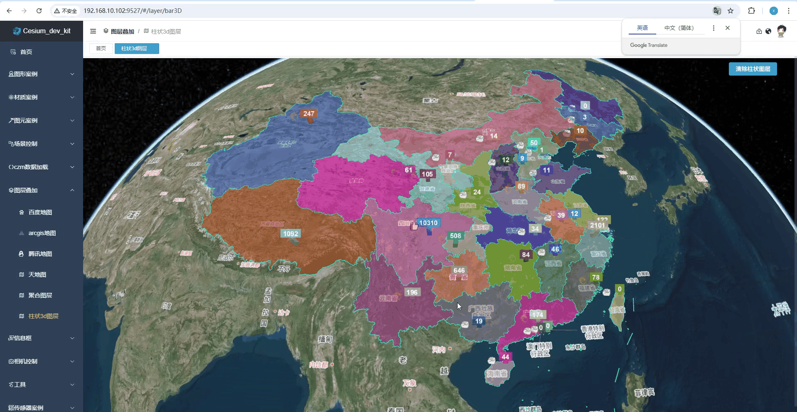   |                 |  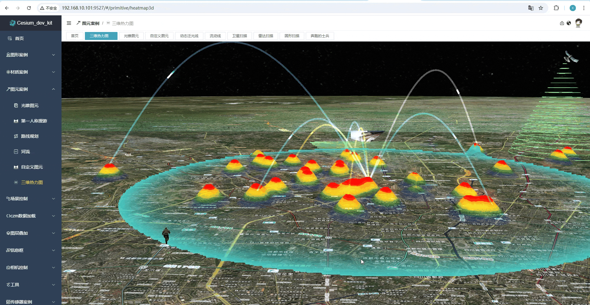  |
|                                                  三维柱状                                                   |                                                           卷帘                                                            |                                                    三维热力                                                     |

[更多>>](https://dengxiaoning.github.io/cesium_dev_kit/demo/?auto=1)

## 安装

```shell
npm install cesium_dev_kit cesium
# 可选：仅 Three.js 集成需要
npm install three
```

> 需要 Cesium `>=1.105`，`three`、`echarts`、`dat.gui`、`libgif` 均为可选 peer 依赖（仅在使用对应功能时安装）。
> 库内不再内置 Cesium Ion token，请通过 `extraConfig.AccessToken` 传入，或在应用入口设置 `Cesium.Ion.defaultAccessToken`。

## Cesium 静态资源（必读）

`cesium_dev_kit` 只负责在 Cesium 之上扩展能力，**不包含 Cesium 自身的运行资源**。首次渲染前，
`Assets/`、`Workers/`、`ThirdParty/` 和 `Widgets/widgets.css` 必须可访问，否则会出现
地球不显示、地形/影像瓦片加载失败、控件没有样式等问题。

**Vite（推荐）**：用插件自动拷贝，不用手写配置。

```bash
npm i -D vite-plugin-cesium
```

```ts
// vite.config.ts
import { defineConfig } from 'vite'
import cesium from 'vite-plugin-cesium'

export default defineConfig({ plugins: [cesium()] })
```

**手动配置（webpack / Rspack / Rollup）**

1. 把 `node_modules/cesium/Build/Cesium/{Assets,Workers,ThirdParty,Widgets}` 拷到静态目录，例如 `public/cesium/`；
2. 在**引入 Cesium 之前**设置 `window.CESIUM_BASE_URL = '/cesium/'`；
3. 引入控件样式：`import 'cesium/Build/Cesium/Widgets/widgets.css'`。

容器必须给明确高度，否则画布高度为 0、页面一片空白：

```css
#cesiumContainer {
  width: 100%;
  height: 100%;
}
```

另外别忘了设置 `Cesium.Ion.defaultAccessToken`，或者通过 `extraConfig.AccessToken` 传入。

## 快速开始（推荐按需引入）

```ts
import * as Cesium from 'cesium'
import { Graphics } from 'cesium_dev_kit/graphics'

// 使用自己的 token，例如从环境变量读取
Cesium.Ion.defaultAccessToken = import.meta.env.VITE_CESIUM_ION_TOKEN

const { viewer, graphics, dispose } = Graphics({
  cesiumGlobal: Cesium,
  containerId: 'cesiumContainer'
})

// 页面 / 路由卸载时释放 kit 自己创建的 viewer
dispose()
```

`cesium_dev_kit/graphics` 不会连带引入 `echarts` / `dat.gui`。可用子路径：
`/graphics`、`/material`、`/primitive`、`/draw`、`/analysis`、`/plugin`、
`/pass-effect`、`/control`、`/three`、`/custom-cesium-plugin`、`/default-static`。

### 默认图片与静态资源

天空盒、点图标、光锥、水面、分析贴图等功能会用到一组默认图片。不传
`defaultStatic` 时，库会使用内置 CDN 配置，保证新项目安装后不会出现 404：

```ts
import { defaultStatic, createDefaultStatic } from 'cesium_dev_kit/default-static'

// 1. 使用内置 CDN（默认）
// 2. 换成自己的 CDN
const myStatic = createDefaultStatic('https://cdn.example.com/')
// 3. 使用相对路径，并把本仓库的 ./public/static 自托管到你的站点
const localStatic = createDefaultStatic('')
```

完整引入：

```ts
import { initCesium } from 'cesium_dev_kit'

const kit = initCesium({
  cesiumGlobal: Cesium,
  containerId: 'cesiumContainer',
  extraConfig: { AccessToken: 'YOUR_CESIUM_ION_TOKEN' }
})

// ...
kit.dispose()
```

### 推荐入口：createKit

`createKit` 与 `initCesium` 参数一致，但返回显式上下文，`dispose()` 的边界也更清楚：

```ts
import * as Cesium from 'cesium'
import { createKit } from 'cesium_dev_kit'

const kit = createKit({
  Cesium,                     // 也可以写 cesiumGlobal
  containerId: 'cesiumContainer',
  assetsBaseUrl: '/static/',  // 等价于 createDefaultStatic('/static/')
  extraConfig: { AccessToken: import.meta.env.VITE_CESIUM_ION_TOKEN },
  onError: (err, ctx) => console.warn(ctx?.scope, err) // 接管非致命错误
})

kit.context.viewer // 与 kit.viewer 相同
kit.graphics.createDynamicCircleGraphics({ /* ... */ })
kit.dispose() // 幂等；kit.isDisposed() 可查询状态
```

约定：

- viewer 由 kit 创建时，`dispose()` 会 `viewer.destroy()`；
- viewer 由调用方传入时，`dispose()` 只清理 kit 自己添加的 DataSource / 监听，不销毁 viewer；
- 同一页面可以创建多个 kit：模块内部不再共享模块级 `Cesium` / `dfSt` 状态；
- 旧写法 `new initCesium({...})` 仍然可用，但已标记为兼容入口，新代码建议用 `createKit`。

### 错误处理

库内主动抛出的错误统一为 `CesiumDevKitError`，带稳定的 `code`：

```ts
import { isCesiumDevKitError, setErrorHandler } from 'cesium_dev_kit'

try {
  const kit = createKit({ Cesium, containerId: 'cesiumContainer' })
} catch (err) {
  if (isCesiumDevKitError(err) && err.code === 'MISSING_VIEWER') {
    // 自己补一个容器
  }
}

// 库内被 catch 掉的非致命错误（销毁失败、可选依赖缺失等）默认 console.warn
setErrorHandler((err, ctx) => console.warn(ctx?.scope, err))
```

错误码：`MISSING_CESIUM`、`MISSING_VIEWER`、`INVALID_ARGUMENT`、`IMAGERY_FAILED`、
`OPTIONAL_DEPENDENCY_MISSING`、`UNSUPPORTED_ENVIRONMENT`、`UNSUPPORTED_CESIUM_VERSION`、`INTERNAL`。

> 命名修正：`craete*` 系列方法已提供正式名 `create*`（如 `craeteDynamicCricleGraphics` →
> `createDynamicCircleGraphics`），旧名保留并标记 `@deprecated`。


### 不用打包器 / script 标签直引

当前发布物只包含 ESM（`dist/*.mjs`）和 CJS（`dist/*.cjs`），**不再发布 `index.umd.js`**，
`window.cesium_dev_kit` 这个全局变量也随之取消 —— 老的
`<script src="index.umd.js">` 写法会 404。如果页面不能上打包器，用 Vite 打一个 `iife` 包再引：

```ts
// vite.config.ts
export default {
  build: {
    lib: { entry: 'src/main.ts', formats: ['iife'], name: 'demo' },
    rollupOptions: { output: { inlineDynamicImports: true } }
  }
}
```

生成的 js 用 `<script>` 引入即可。如果需要官方重新提供 UMD 构建，欢迎提 issue。

## 部署

```shell
npm install
npm run dev          # 查看案例
npm run typecheck
npm test
npm run build:lib    # 将插件打包，其中包含 ESM + CJS + .d.ts + 源码
npm run build        # 查看案例 
```

---

## 使用范例

- ES6 使用案例
  [https://github.com/dengxiaoning/cesium_kit_test](https://github.com/dengxiaoning/cesium_kit_test)

- React Use case
  [https://github.com/dengxiaoning/react-cesium](https://github.com/dengxiaoning/react-cesium)
- H5 使用案例
  [https://github.com/dengxiaoning/cesium_kit_test_h5](https://github.com/dengxiaoning/cesium_kit_test_h5)

## 捐赠

你是否使用并喜欢 cesium_dev_kit，但你没有找到一种方式来表达你的喜欢? 如果是，请考虑捐款来支持这个项目。或许不是也不用担心，不管有没有支持，我都会继续维护这个项目。不过，如果你请我喝杯咖啡，我会非常高兴 😄

- [](https://paypal.me/xiaoningdeng?country.x=C2&locale.x=en_US)

- [GitHub Sponsors](https://github.com/sponsors/dengxiaoning)

##

## 浏览器支持

本地开发推荐使用`Chrome 80+` 浏览器

支持现代（chrome，Firefox，Microsoft edge，etc.）浏览器, 不支持 IE

## 鸣谢

[cesium-d3kit](https://github.com/zhangti0708/cesium-d3kit)<br/>
[drawarrowforcesium](https://gitcode.net/mirrors/gitgitczl/drawarrowforcesium)<br/>
[vue3-ts-cesium-map-show](https://gitee.com/hawk86104/vue3-ts-cesium-map-show)<br/>

本项目包括但不限于借鉴和参考以上资料，非常感谢作者分享

## 项目不足与优化

- 1、Cesium 相关类型暂以宽松（`any`）为主，以兼容通过 CDN / 全局 `window.Cesium` 引入的方式；若使用 npm 安装的 cesium，可自行扩展精确类型
- 2、错误已统一为 `CesiumDevKitError`（稳定 code），非致命错误走 `setErrorHandler`；少数旧工具方法仍会静默吞掉异常
- 3、单元测试覆盖纯算法层（12 个套件），浏览器 / DOM 级集成测试与 Cesium 版本矩阵仍缺失

## 如何贡献

<a href="https://github.com/dengxiaoning/cesium_dev_kit/graphs/contributors">
  
</a>

你可以[提一个 issue](https://github.com/dengxiaoning/cesium_dev_kit/issues/new) 或者提交一个 Pull Request。

更多贡献详情见[CONTRIBUTING](./CONTRIBUTING.md)...

---

## `Star`

非常感谢留下星星的好心人，感谢您的支持 :heart:

[查看全部 Stargazers](https://github.com/dengxiaoning/cesium_dev_kit/stargazers) · [Star 增长曲线](https://api.star-history.com/svg?repos=dengxiaoning/cesium_dev_kit&type=Date)

## `Fork`

@sincely、`@ooil929`、 @InPanda、 `luyufanzhi`、AllenChiangCN、`Liquid-Zhangliquan` :heart:

[查看全部 Fork](https://github.com/dengxiaoning/cesium_dev_kit/network/members)

[npm]: https://img.shields.io/npm/v/cesium_dev_kit
[npm-url]: https://www.npmjs.com/package/cesium_dev_kit
[build-size]: https://img.shields.io/bundlephobia/minzip/cesium_dev_kit/1.0.70?logo=travis
[build-size-url]: https://img.shields.io/bundlephobia/minzip/cesium_dev_kit
[npm-download]: https://img.shields.io/npm/dy/cesium_dev_kit?logo=npm
[npmtrends-url]: https://www.npmtrends.com/cesium_dev_kit
[license-uri]: https://img.shields.io/npm/l/cesium_dev_kit.svg
[license-link]: https://npm.im/cesium_dev_kit
[build-status]: https://github.com/dengxiaoning/cesium_dev_kit
[build-main]: https://img.shields.io/github/actions/workflow/status/dengxiaoning/cesium_dev_kit/project-build.yml?branch=main&logo=github
[repo-stars]: https://img.shields.io/github/stars/dengxiaoning/cesium_dev_kit?style=plastic&logo=github
[star-chart]: https://api.star-history.com/svg?repos=dengxiaoning/cesium_dev_kit&type=Date
